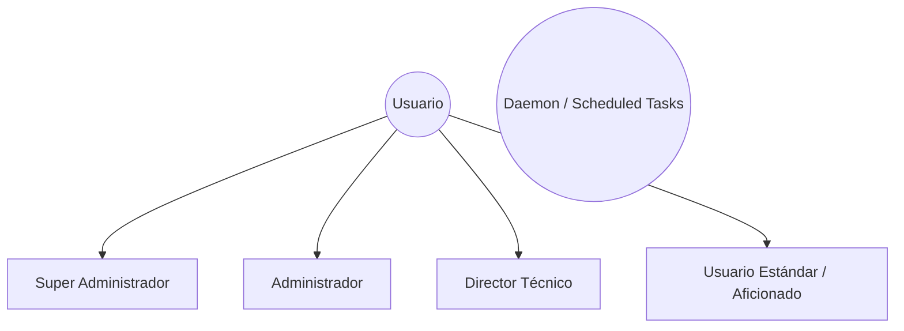

# Documento de Visión y Alcance del Producto
## Metodología RUP — Fase de Inicio (Inception)

**Proyecto:** Plataforma Integral de Gestión Deportiva, Reservas y Seguridad ("FUTBOL S.A.")  
**Versión del Documento:** 1.0.0  
**Fecha:** 2026-11-24  
**Estado:** Aprobado para Elaboración y Construcción

---

## 1. Oportunidad de Negocio y Planteamiento del Problema

### 1.1. Contexto Actual
Los complejos deportivos y clubes enfrentan severas dificultades organizativas y operativas al coordinar el alquiler de canchas de fútbol (Fútbol 5, Fútbol 7, Fútbol 11), validar comprobantes de pago de manera manual, evitar solapamientos u ocupaciones conflictivas de horarios, y garantizar que los encuentros deportivos sean competitivamente equilibrados. Asimismo, los sistemas tradicionales carecen de mecanismos modernos de ciberseguridad, gestión granular de identidades (RBAC) y trazabilidad inmutable de eventos.

### 1.2. Declaración del Problema

| Elemento | Descripción |
| :--- | :--- |
| **El problema de...** | Desorganización en la reserva de canchas, conflictos de horarios, asignación desbalanceada de jugadores en partidos y vulnerabilidades en la gestión de accesos. |
| **Afecta a...** | Administradores de complejos deportivos, directores técnicos de equipos y futbolistas aficionados. |
| **El impacto es...** | Pérdidas económicas por canchas ociosas o sobrevendidas, frustración deportiva por partidos desiguales, riesgo de fraude en pagos y brechas de seguridad en identidades de usuarios. |
| **Una solución exitosa sería...** | Una plataforma web unificada con Clean Architecture, seguridad dual-token con BCrypt, motor inteligente de verificación de disponibilidad horaria en tiempo real, clasificador semafórico de urgencia de reservas, gestión de plantel con calificación de estrellas y algoritmo automatizado de balanceo deportivo (Snake Draft). |

---

## 2. Stakeholders y Actores del Sistema

### 2.1. Perfiles de Usuarios y Actores
1. **Super Administrador (`ROLE_SUPER_ADMIN`):** Propietario de la plataforma. Posee control absoluto sobre configuraciones del sistema, parámetros dinámicos, tarifas base, altas masivas, gestión de roles y auditoría global.
2. **Administrador (`ROLE_ADMIN`):** Encargado de la operación diaria del complejo deportivo. Evalúa y aprueba/rechaza solicitudes de técnicos, aprueba reservas de canchas, resuelve alertas del semáforo y supervisa directores técnicos y jugadores.
3. **Director Técnico (`ROLE_TECNICO`):** Organizador de partidos y líder de plantel. Una vez aprobado por administración, solicita reservas de cancha, adjunta comprobantes de pago, administra su nómina de jugadores calificados por estrellas y organiza encuentros equilibrados.
4. **Usuario Estándar / Aficionado (`ROLE_USER` / `Público`):** Futbolista o seguidor que consulta la disponibilidad pública de canchas, explora los partidos programados en cartelera y gestiona sus credenciales personales.
5. **Daemon del Sistema (Cron / Background Processor):** Actor temporal automatizado que ejecuta transiciones de estado por expiración de tiempo (cierre de reservas, pase a partidos en juego y alertas matutinas de semáforo rojo).

---

## 3. Objetivos del Producto

1. **Garantizar Cero Conflictos Horarios:** Eliminar el 100% de solapamientos en reservas de canchas mediante validación transaccional estricta en base de datos.
2. **Optimizar la Tasa de Respuesta Administrativa:** Reducir el tiempo de atención de solicitudes mediante un panel visual de semáforo de urgencia ($\le 2$ días en rojo, 3 días en ámbar).
3. **Maximizar la Equidad Deportiva:** Proveer un algoritmo de balanceo automático (Snake Draft) que distribuya equitativamente a los jugadores convocados según su nivel de habilidad ($1 \dots 5$ estrellas).
4. **Cumplir Estándares de Seguridad Bancaria/Empresarial:** Implementar flujo Dual-Token con almacenamiento seguro en memoria volátil de Angular y cookie rotativa `HttpOnly; SameSite=Strict`, hashing BCrypt factor 12, limitador de tasa Token Bucket y defensas anti-enumeración de usuarios (*timing-safe*).

---

## 4. Alcance del Sistema

### 4.1. Módulos Comprendidos en el Alcance
- **Módulo 1: Seguridad, Identidad y Control de Acceso (IAM):** Autenticación dual-token, rate limiting, control de fuerza bruta, autoregistro configurable, flujo de aprobación de técnicos, reseteo de claves y perfil con avatar.
- **Módulo 2: Infraestructura y Reservas de Canchas:** Catálogo de canchas (F5, F7, F11), fijación de tarifas por hora, solicitud horaria por horas enteras (hasta 24 hrs), validación transaccional anti-cruces, subida de vouchers, cancelación con anticipación y semáforo de alertas.
- **Módulo 3: Plantel de Jugadores y Rendimiento:** Ficha técnica de jugadores, posición táctica, foto miniatura y calificación de estrellas con historial inmutable de variaciones.
- **Módulo 4: Organización de Encuentros y Wizard Deportivo:** Creación de encuentros sobre reservas confirmadas, configuración de equipos (4 a 8 jugadores), balanceo determinístico Snake Draft, publicación en cartelera y transiciones de estado automáticas (`PUBLICADO` $\rightarrow$ `EN_JUEGO` $\rightarrow$ `FINALIZADO`).
- **Módulo 5: Transversal de Notificaciones y Auditoría Forense:** Notificaciones push internas vinculadas a rutas del sistema y registro inmutable de auditoría con IP, User-Agent y marcas de tiempo.

### 4.2. Límites y Exclusiones
- El sistema no procesa pagos con pasarelas de tarjetas de crédito en línea en esta versión; opera mediante carga y validación visual de comprobantes de transferencia (vouchers bancarios).
- No incluye streaming de video de partidos ni geolocalización por GPS de canchas.

---

## 5. Requisitos No Funcionales (Modelo FURPS+)

### 5.1. Funcionalidad (Functionality)
- **Criptografía Robusta:** Hashing de contraseñas mediante **BCrypt con factor de coste 12** ($2^{12} = 4096$ iteraciones).
- **Zero-Knowledge Frontend:** Ningún hash, token de refresco sensible o secreto del servidor se expone en respuestas JSON de usuario.
- **Protección Timing-Safe:** Tiempos de respuesta estandarizados en recuperación de contraseñas mediante cálculo dummy de BCrypt ante correos inexistentes.

### 5.2. Usabilidad (Usability)
- **Diseño Ergonómico Responsive:** Interfaz moderna con paleta azul `#0066FF`, menús colapsables, componentes Angular Material y SweetAlert2 para diálogos modales interactivos.
- **Feedback Inmediato:** Previsualización reactiva de fotos de perfil, vouchers y cálculo dinámico de montos en función de la duración de reserva seleccionada.

### 5.3. Confiabilidad (Reliability)
- **Tolerancia a Concurrencia:** Verificación transaccional `@Transactional` en base de datos para impedir que dos administradores aprueben solicitudes solapadas.
- **Bloqueo Defensivo:** Cuentas bloqueadas automáticamente por 15 minutos tras 5 intentos fallidos consecutivos de inicio de sesión.
- **Detección de Reutilización de Tokens:** Revocación masiva de sesiones si un token de refresco revocado intenta ser presentado nuevamente.

### 5.4. Rendimiento (Performance)
- **Latencia:** Percentil $p95 < 200\text{ ms}$ en autenticación y $< 50\text{ ms}$ en consultas de disponibilidad y calendarios cacheados.
- **Optimización SQL:** Batching de Hibernate configurado a 50 (`order_inserts: true`, `order_updates: true`), eliminación de problemas $N+1$ mediante fetch joins y caché L2 en memoria con Caffeine.

### 5.5. Soportabilidad (Supportability)
- **Arquitectura Limpia:** Separación estricta entre capa de Dominio, Aplicación, Infraestructura Web y Frontend Angular Standalone.
- **Base de Datos Embebida:** Base de datos H2 en memoria (`jdbc:h2:mem:seguridad_db;MODE=PostgreSQL`) con consola web habilitada para desarrollo y scripts de inicio desatendido.
