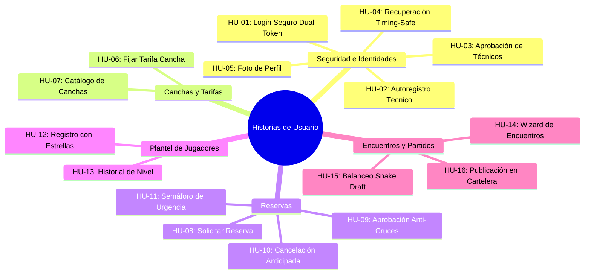
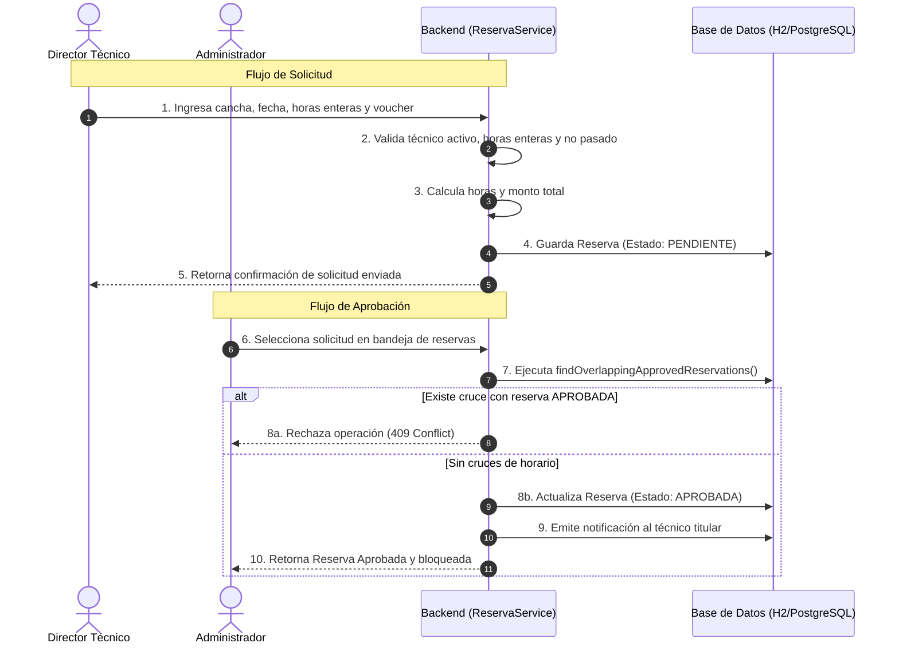

# Historias de Usuario y Especificación de Casos de Uso
## Metodología RUP — Fase de Inicio (Inception)

**Proyecto:** Plataforma Integral de Gestión Deportiva ("FUTBOL S.A.")  
**Metodología:** RUP (Requisitos basados en Casos de Uso y Metodologías Ágiles mediante User Stories)  
**Fecha:** 2026-11-24  

---

## 1. Catálogo de Historias de Usuario (User Stories)

Las historias de usuario están estructuradas siguiendo el estándar `Como [Rol] Quiero [Acción] Para [Beneficio]` e incluyen Criterios de Aceptación bajo sintaxis formal Given-When-Then (Gherkin).

---

### Épica 1: Seguridad, Identidad y Control de Acceso (IAM)

#### **HU-01: Inicio de Sesión Seguro Dual-Token**
- **Como** usuario registrado del sistema (Super Admin, Admin, Técnico o Usuario),
- **Quiero** iniciar sesión ingresando mi correo electrónico y contraseña,
- **Para** acceder a las funcionalidades autorizadas de acuerdo con mi rol asignado.
- **Criterios de Aceptación:**
  - **Escenario 1 (Acceso Válido):**  
    *Dado* que el usuario está activo y no bloqueado,  
    *Cuando* envía correo y contraseña correctos,  
    *Entonces* el sistema retorna HTTP 200 con un JWT Access Token (15 min) en memoria, emite una cookie segura rotativa `app_refresh_token` (7 días, `HttpOnly`, `SameSite=Strict`), reinicia los intentos fallidos a 0 y registra el evento `LOGIN_SUCCESS` en auditoría.
  - **Escenario 2 (Credenciales Inválidas y Bloqueo Defensivo):**  
    *Dado* que el usuario ingresa una contraseña errónea,  
    *Cuando* el intento falla,  
    *Entonces* el sistema incrementa el contador de fallos. Al llegar al 5.° intento fallido, bloquea la cuenta por 15 minutos (`account_non_locked = false`), rechaza con HTTP 401/423 y registra `LOGIN_BLOCKED`.
  - **Escenario 3 (Rate Limiting por IP):**  
    *Dado* que una IP realiza más de 10 peticiones de autenticación en 1 minuto,  
    *Cuando* intenta una nueva solicitud,  
    *Entonces* el limitador Token Bucket rechaza la petición con HTTP 429 Too Many Requests.

#### **HU-02: Registro Público de Directores Técnicos**
- **Como** director técnico de fútbol aficionado,
- **Quiero** registrar mis datos personales, teléfono, correo y contraseña en un formulario público,
- **Para** postular a una cuenta organizadora de partidos en el complejo deportivo.
- **Criterios de Aceptación:**
  - **Escenario 1 (Registro Exitoso en Estado Pendiente):**  
    *Dado* que el correo no existe en el sistema y las contraseñas coinciden (con mayúscula, minúscula y número),  
    *Cuando* el técnico envía el formulario,  
    *Entonces* el sistema crea la cuenta con rol `ROLE_TECNICO`, estado de aprobación `PENDIENTE` y notifica al usuario que su expediente será evaluado por un administrador.
  - **Escenario 2 (Restricción Operativa en Estado Pendiente):**  
    *Dado* que el técnico tiene estado `PENDIENTE`,  
    *Cuando* intenta solicitar una reserva o registrar jugadores,  
    *Entonces* el backend rechaza la operación con `SecurityException` (403 Forbidden).

#### **HU-03: Aprobación y Gobierno Administrativo de Técnicos**
- **Como** administrador del sistema,
- **Quiero** visualizar la lista de técnicos postulantes y poder aprobarlos o rechazarlos con motivo justificado,
- **Para** controlar qué organizadores están facultados para utilizar las instalaciones.
- **Criterios de Aceptación:**
  - **Escenario 1 (Aprobación):**  
    *Dado* un técnico en estado `PENDIENTE`,  
    *Cuando* el administrador hace clic en "Aprobar",  
    *Entonces* el estado transiciona a `ACTIVO`, se asocia `aprobadoPor`, se registra la fecha de decisión y se envía una notificación interna al técnico habilitándolo para operar.
  - **Escenario 2 (Rechazo con Motivo Obligatorio):**  
    *Dado* un técnico postulante,  
    *Cuando* el administrador intenta rechazarlo ingresando un motivo con menos de 10 caracteres,  
    *Entonces* el sistema rechaza la acción con `IllegalArgumentException` exigiendo un motivo detallado. Al cumplir $\ge 10$ caracteres, el estado pasa a `RECHAZADO`.

#### **HU-04: Recuperación de Contraseña con Protección Anti-Enumeración**
- **Como** usuario que olvidó su clave de acceso,
- **Quiero** solicitar un enlace de restablecimiento ingresando mi correo,
- **Para** redefinir mi contraseña de forma segura sin exponer si mi correo está registrado.
- **Criterios de Aceptación:**
  - **Escenario 1 (Correo Registrado):**  
    *Dado* un correo existente,  
    *Cuando* se solicita la recuperación,  
    *Entonces* se genera un token de 15 minutos en `password_reset_tokens` y se envía por correo electrónico.
  - **Escenario 2 (Protección Timing-Safe para Correo Inexistente):**  
    *Dado* un correo que no existe en la base de datos,  
    *Cuando* se envía la solicitud,  
    *Entonces* el backend ejecuta un cálculo dummy de BCrypt con 4096 iteraciones y devuelve el mismo mensaje genérico de éxito en idéntico tiempo de respuesta.

#### **HU-05: Gestión de Foto de Perfil y Avatar Reactivo**
- **Como** usuario autenticado,
- **Quiero** subir una fotografía personal o quitarla desde mi perfil,
- **Para** personalizar mi avatar en la barra de navegación y en el sistema.
- **Criterios de Aceptación:**
  - **Escenario 1 (Carga de Imagen Válida):**  
    *Dado* un archivo JPG, PNG o WEBP de hasta 5 MB,  
    *Cuando* el usuario pulsa "Cambiar Foto",  
    *Entonces* el backend guarda el archivo en `uploads/avatars/`, actualiza `users.avatar_url`, devuelve el perfil actualizado y la UI refleja la imagen de inmediato en el perfil y en el top-bar.
  - **Escenario 2 (Eliminación de Foto):**  
    *Dado* un usuario con foto asignada,  
    *Cuando* pulsa "Quitar Foto" y confirma el diálogo SweetAlert2,  
    *Entonces* `avatar_url` pasa a `null` y la UI conmuta a las iniciales dinámicas calculadas a partir de su nombre.

---

### Épica 2: Infraestructura Deportiva y Tarifas de Canchas

#### **HU-06: Fijación y Actualización de Tarifas de Cancha**
- **Como** Super Administrador o Administrador,
- **Quiero** consultar las canchas disponibles y modificar su tarifa por hora en Soles (S/),
- **Para** reflejar los precios vigentes del complejo deportivo en las cotizaciones de reservas.
- **Criterios de Aceptación:**
  - **Escenario 1 (Actualización Exitosa):**  
    *Dado* un precio mayor a cero (ej. S/ 95.00),  
    *Cuando* el administrador hace clic en "Fijar Precio" desde el panel de Configuración,  
    *Entonces* el backend actualiza `canchas.tarifa_hora` y las futuras reservas calculan su monto con el nuevo valor.
  - **Escenario 2 (Tarifa Inválida):**  
    *Dado* un valor nulo o $\le 0$,  
    *Cuando* se intenta enviar,  
    *Entonces* el sistema rechaza la operación con `IllegalArgumentException("La tarifa por hora debe ser mayor a cero.")`.

---

### Épica 3: Gestión de Reservas de Canchas y Semáforos

#### **HU-07: Solicitud de Reserva de Cancha por Horas Enteras**
- **Como** Director Técnico activo,
- **Quiero** seleccionar una cancha deportiva, fecha, hora de inicio y hora de fin consecutivas y adjuntar opcionalmente mi comprobante,
- **Para** agendar el espacio físico para los encuentros de mi equipo.
- **Criterios de Aceptación:**
  - **Escenario 1 (Horas Enteras Obligatorias):**  
    *Dado* un horario entre 08:00 y 24:00,  
    *Cuando* el técnico selecciona hora de inicio (minutos en `:00`) y hora de fin (minutos en `:00` o `23:59`),  
    *Entonces* el sistema calcula la duración exacta en horas, valida que esté entre 1 y 24 horas, calcula el monto total (`tarifaHora * horas`) y crea la reserva en estado `PENDIENTE`.
  - **Escenario 2 (Rechazo de Horario en el Pasado):**  
    *Dado* un intento de reserva para una fecha anterior a hoy o una hora previa a la hora actual en Lima,  
    *Cuando* se envía la solicitud,  
    *Entonces* el backend responde con HTTP 400 (`IllegalArgumentException("No se pueden solicitar reservas para fechas u horas en el pasado.")`).

#### **HU-08: Aprobación Transaccional con Verificación Anti-Cruces**
- **Como** Administrador del complejo,
- **Quiero** revisar una reserva pendiente y aprobarla con validación en tiempo real,
- **Para** garantizar que ninguna otra reserva confirmada ocupe la misma cancha en el mismo horario.
- **Criterios de Aceptación:**
  - **Escenario 1 (Aprobación sin Cruces):**  
    *Dado* que no existen reservas `APROBADA` para la misma cancha en el intervalo solicitado ($I_1 < F_2 \land F_1 > I_2$),  
    *Cuando* el administrador confirma la aprobación,  
    *Entonces* la reserva pasa a `APROBADA`, se notifica al técnico titular y se bloquea formalmente el horario.
  - **Escenario 2 (Detección de Cruce Horario):**  
    *Dado* que otra reserva ya fue aprobada en el mismo intervalo,  
    *Cuando* se intenta aprobar la segunda solicitud,  
    *Entonces* el backend aborta la transacción con HTTP 409 Conflict (`IllegalStateException("Conflicto de horario: Ya existe una reserva aprobada...")`).

#### **HU-09: Cancelación con Ventana Mínima de Anticipación**
- **Como** Director Técnico,
- **Quiero** poder cancelar una reserva programada que ya no utilizaré,
- **Para** liberar la cancha y evitar penalizaciones deportivas.
- **Criterios de Aceptación:**
  - **Escenario 1 (Cancelación Válida con $\ge 24$ horas):**  
    *Dado* que faltan al menos 24 horas para el inicio del partido,  
    *Cuando* el técnico cancela la reserva,  
    *Entonces* la reserva pasa a `CANCELADA`, y si tenía un encuentro creado, dicho encuentro pasa a `CANCELADO` automáticamente en cascada lógica.
  - **Escenario 2 (Intento Tardío con $< 24$ horas):**  
    *Dado* que faltan menos de 24 horas para el horario reservado,  
    *Cuando* el técnico intenta cancelar,  
    *Entonces* el sistema rechaza la cancelación con `IllegalStateException("Solo puedes cancelar con al menos 24 horas de anticipación.")`.

#### **HU-10: Semáforo de Urgencia y Alertas Preventivas**
- **Como** Administrador,
- **Quiero** una vista dedicada que clasifique las reservas pendientes con colores semafóricos y badges de conflicto,
- **Para** priorizar la atención de solicitudes próximas a vencer o que presentan solapamientos.
- **Criterios de Aceptación:**
  - **Escenario 1 (Categorización):**  
    *Dado* el conjunto de reservas pendientes,  
    *Entonces* las solicitudes con $\le 2$ días restantes se marcan en **ROJO**, las de 3 días en **ÁMBAR**, y las de $\ge 4$ días en **VERDE**. Si una solicitud pendiente coincide en horario con otra aprobada, se enciende la bandera `enConflicto = true`.
  - **Escenario 2 (Alerta Diaria Matutina):**  
    *Dado* que son las 08:00 AM (hora Lima),  
    *Cuando* el daemon detecta reservas rojas pendientes,  
    *Entonces* despacha una notificación push a todos los administradores (`ALERTA_SEMAFORO_ROJO`).

---

### Épica 4: Plantel de Jugadores y Rendimiento

#### **HU-11: Registro y Calificación de Jugadores por Estrellas**
- **Como** Director Técnico,
- **Quiero** añadir jugadores a mi plantel indicando nombre, apodo, posición táctica, foto y nivel de estrellas (1 a 5),
- **Para** armar mi catálogo de futbolistas convocables para partidos.
- **Criterios de Aceptación:**
  - **Escenario 1 (Rango de Estrellas Válido):**  
    *Dado* un valor de estrellas entre 1 y 5,  
    *Cuando* se registra el jugador,  
    *Entonces* se guarda con `activo = true` asignado al técnico autenticado.
  - **Escenario 2 (Rango Inválido):**  
    *Dado* un valor $< 1$ o $> 5$,  
    *Cuando* se envía la solicitud,  
    *Entonces* el sistema arroja `IllegalArgumentException("Las estrellas deben estar entre 1 y 5.")`.

#### **HU-12: Historial Inmutable de Modificación de Estrellas**
- **Como** Administrador o Técnico,
- **Quiero** que cada vez que se modifiquen las estrellas de un jugador se registre una entrada histórica,
- **Para** auditar la evolución deportiva del jugador y evitar manipulaciones previas a los partidos.
- **Criterios de Aceptación:**
  - **Escenario 1 (Registro Histórico Automático):**  
    *Dado* un jugador con 3 estrellas,  
    *Cuando* el técnico actualiza su nivel a 5 estrellas,  
    *Entonces* el sistema inserta un registro en `jugador_historial_estrellas` con `estrellas_anterior = 3`, `estrellas_nueva = 5`, `cambiado_por` y la marca temporal exacta.

---

### Épica 5: Encuentros, Convocatorias y Balanceo Deportivo

#### **HU-13: Creación de Encuentro sobre Reserva Aprobada**
- **Como** Director Técnico,
- **Quiero** crear una convocatoria deportiva vinculada a una de mis reservas aprobadas,
- **Para** iniciar la preparación de un partido.
- **Criterios de Aceptación:**
  - **Escenario 1 (Reserva Aprobada y Única):**  
    *Dado* que la reserva está en estado `APROBADA` y no tiene ningún encuentro asociado previo,  
    *Cuando* el técnico define nombre y monto de apuesta opcional ($> 0$),  
    *Entonces* el encuentro se crea en estado `BORRADOR`.

#### **HU-14: Balanceo Automático de Equipos (Snake Draft)**
- **Como** Director Técnico,
- **Quiero** seleccionar un grupo de jugadores convocados y pulsar "Balancear Equipos",
- **Para** que el sistema proponga alineaciones equilibradas en nivel de habilidad sin favoritismos.
- **Criterios de Aceptación:**
  - **Escenario 1 (Ejecución del Algoritmo):**  
    *Dado* un conjunto de jugadores con diversas estrellas,  
    *Cuando* se ejecuta el balanceo para $N=2$ equipos,  
    *Entonces* el sistema ordena por estrellas descendente y distribuye en patrón serpiente ($A, B, B, A, A \dots$) respetando el tope de 8 jugadores por equipo, y devuelve el total de estrellas y promedio por equipo redondeado a 1 decimal.

#### **HU-15: Publicación de Encuentro en Cartelera Pública**
- **Como** Director Técnico,
- **Quiero** publicar mi encuentro una vez que los equipos estén definidos reglamentariamente,
- **Para** que la comunidad de aficionados pueda visualizar el partido en la cartelera principal.
- **Criterios de Aceptación:**
  - **Escenario 1 (Composición Válida 4 a 8 Jugadores):**  
    *Dado* que la reserva no ha expirado y cada equipo tiene entre 4 y 8 jugadores activos no repetidos,  
    *Cuando* el técnico pulsa "Publicar Encuentro",  
    *Entonces* el estado pasa a `PUBLICADO` y se expone de inmediato en el portal público de partidos confirmados.
  - **Escenario 2 (Regla de Edición Límite de 2 Horas):**  
    *Dado* un encuentro publicado,  
    *Cuando* el técnico intenta editar las alineaciones faltando menos de 2 horas para el inicio del partido,  
    *Entonces* el sistema bloquea los cambios con `IllegalStateException("Solo se permite editar jugadores hasta 2 horas antes...")`.

---

## 2. Especificación Formal de Casos de Uso del Sistema (RUP Use Cases)

A continuación se detallan las especificaciones completas de los Casos de Uso arquitecturalmente más significativos:

### Caso de Uso CU-01: Solicitar y Aprobar Reserva de Cancha

- **Actor Principal:** Director Técnico / Administrador.
- **Precondiciones:** Técnico activo autenticado con token JWT; cancha activa en el sistema.
- **Flujo Principal:**
  1. El técnico ingresa al formulario de reservas, selecciona cancha, fecha y horario en horas enteras.
  2. El sistema calcula en vivo la duración y el monto estimado en Soles (`tarifaHora * horas`).
  3. El técnico adjunta opcionalmente su voucher de pago y envía la solicitud.
  4. El sistema valida reglas de negocio (fecha no pasada, duración entre 1 y 24 h) y persiste la reserva en estado `PENDIENTE`.
  5. Se emite notificación al administrador.
  6. El administrador ingresa a la bandeja de solicitudes o semáforo de alertas.
  7. El administrador pulsa "Aprobar Reserva".
  8. El sistema consulta en base de datos si existe alguna reserva `APROBADA` solapada en el mismo intervalo.
  9. Al constatar ausencia de cruces, actualiza el estado a `APROBADA` con la fecha y firma del administrador.
  10. Se notifica al técnico titular con enlace directo para crear el encuentro.
- **Flujos Alternativos:**
  - *4a. Horario en el Pasado:* El sistema rechaza con HTTP 400 y muestra alerta informativa.
  - *8a. Cruce Detectado:* El sistema detecta una reserva confirmada en ese intervalo, aborta la transacción y muestra alerta de conflicto de horario (HTTP 409).
  - *7b. Rechazo:* El administrador rechaza la reserva ingresando el motivo obligatorio; la reserva pasa a `RECHAZADA` y se notifica al técnico.
- **Postcondiciones:** El horario queda bloqueado y protegido contra cualquier otra confirmación para esa cancha.

---

### Caso de Uso CU-02: Orquestación y Balanceo de Encuentro Deportivo

- **Actor Principal:** Director Técnico.
- **Precondiciones:** Tener una reserva en estado `APROBADA` que no cuente con un encuentro previamente asociado.
- **Flujo Principal:**
  1. El técnico ingresa a "Crear Encuentro" seleccionando su reserva aprobada.
  2. Ingresa el nombre del encuentro (ej. "Clásico Nocturno F5"), imagen de banner y monto de apuesta (opcional).
  3. El sistema valida unicidad y crea el registro en estado `BORRADOR`.
  4. El técnico selecciona los futbolistas convocados de su plantel.
  5. El técnico pulsa "Balancear Equipos".
  6. El sistema ejecuta el algoritmo **Snake Draft** ordenando a los jugadores por estrellas e intercalándolos en patrón serpiente para dos equipos.
  7. El sistema muestra la propuesta con totales de estrellas y promedios por equipo.
  8. El técnico aprueba la conformación y guarda los equipos.
  9. El técnico pulsa "Publicar Encuentro".
  10. El sistema verifica que cada equipo cuente con entre 4 y 8 jugadores reglamentarios y que la reserva no haya vencido.
  11. El encuentro transiciona a `PUBLICADO` y se expone en la cartelera comunitaria.
- **Flujos Alternativos:**
  - *6a. Cupo Excedido:* Si un equipo excede 8 jugadores, el sistema impide el guardado.
  - *10a. Jugador Duplicado:* Si un jugador figura en dos equipos del mismo encuentro, se rechaza la operación.
  - *10b. Edición Tardía:* Si el técnico intenta alterar los jugadores faltando menos de 2 horas para el partido, se bloquea la acción.
- **Postcondiciones:** El partido queda confirmado para su disputa y entra en el ciclo de transiciones automáticas del cron.
