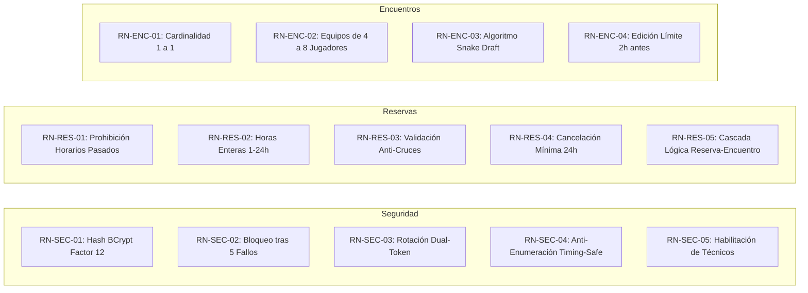

# Glosario del Dominio y Catálogo de Reglas de Negocio
## Metodología RUP — Fase de Inicio (Inception)

**Proyecto:** Plataforma Integral de Gestión Deportiva ("FUTBOL S.A.")  
**Metodología:** RUP (Modelado del Negocio y Requisitos)  
**Fecha:** 2026-11-24  

---

## 1. Glosario de Términos del Dominio

A continuación se definen los términos y conceptos del negocio utilizados transversalmente en los artefactos RUP y en el código fuente:

| Término | Definición en el Contexto del Negocio |
| :--- | :--- |
| **Cancha Deportiva** | Espacio físico e infraestructura donde se disputan encuentros de fútbol. Se clasifica por tipo de superficie y capacidad reglamentaria: Fútbol 5 (`F5`), Fútbol 7 (`F7`) y Fútbol 11 (`F11`). Cada cancha posee una tarifa horaria propia expresada en moneda nacional (PEN / Soles). |
| **Reserva** | Solicitud y asignación formal de un intervalo de tiempo exclusivo (fecha, hora inicio y hora fin) sobre una cancha deportiva. Pasa por diferentes estados administrativos (`PENDIENTE`, `APROBADA`, `RECHAZADA`, `CANCELADA`, `VENCIDA`, `FINALIZADA`). |
| **Tarifa por Hora** | Precio unitario fijado por la administración para el uso de una cancha durante un lapso de 60 minutos. El monto final de la reserva se obtiene de multiplicar esta tarifa por la cantidad de horas reservadas. |
| **Comprobante de Pago (Voucher)** | Archivo digital (imagen JPG, PNG o documento PDF) que evidencia la transferencia bancaria o depósito realizado por el Director Técnico para respaldar su solicitud de alquiler. |
| **Semáforo de Alertas** | Mecanismo visual de priorización que clasifica las reservas pendientes según la inmediatez de la fecha solicitada: **Rojo** ($\le 2$ días), **Ámbar** (3 días) y **Verde** ($\ge 4$ días). |
| **Conflicto de Horario (Cruce)** | Situación en la que dos reservas intentan utilizar la misma cancha deportiva en un intervalo de tiempo que se solapa $[I_1 < F_2 \land F_1 > I_2]$. Solo puede existir una reserva `APROBADA` por intervalo. |
| **Director Técnico (DT)** | Usuario con rol `ROLE_TECNICO` autorizado para registrar su plantilla de jugadores, solicitar canchas, armar equipos y convocar encuentros deportivos. Requiere aprobación administrativa para estar en estado `ACTIVO`. |
| **Jugador** | Deportista aficionado registrado en el plantel de un Director Técnico. Posee atributos de nombre, apodo, posición táctica y una calificación de estrellas. |
| **Calificación de Estrellas** | Puntuación numérica entera en el rango $[1, 5]$ asignada a un jugador para representar su habilidad técnica y condición física. Se utiliza como insumo fundamental para el balanceo equitativo de equipos. |
| **Historial de Estrellas** | Registro inmutable de auditoría deportiva que almacena cada modificación sufrida en las estrellas de un jugador, indicando el valor anterior, el nuevo valor, el usuario responsable y la fecha/hora exacta. |
| **Encuentro** | Evento deportivo o partido organizado sobre una reserva previamente confirmada (`APROBADA`). Contiene la convocatoria de jugadores, la distribución en equipos y el monto de apuesta (opcional). |
| **Snake Draft (Distribución Serpiente)** | Algoritmo determinístico de balanceo deportivo que ordena los jugadores por estrellas en orden descendente y los distribuye alternando el orden de selección entre rondas ($A \rightarrow B$, luego $B \rightarrow A$, luego $A \rightarrow B \dots$), asegurando paridad de nivel competitivo. |
| **Autenticación Dual-Token** | Arquitectura de seguridad basada en dos tokens complementarios: un *Access Token* JWT de corta duración (15 minutos) almacenado únicamente en memoria volátil de la aplicación web, y un *Refresh Token* rotativo de larga duración (7 días) encapsulado en una cookie segura con banderas `HttpOnly; SameSite=Strict`. |
| **Token Replay Attack** | Ataque cibernético consistente en reutilizar un token de refresco que ya fue previamente rotado o revocado. El sistema lo detecta como indicio de sustracción de credenciales y reacciona revocando masivamente todas las sesiones activas del usuario. |
| **Timing-Safe Protection** | Técnica de programación defensiva aplicada en endpoints sensibles (ej. recuperación de contraseñas) para igualar el tiempo de cómputo del servidor tanto si el usuario existe como si no, impidiendo la enumeración de cuentas mediante ataques de temporización. |
| **Role-Based Access Control (RBAC)** | Modelo de autorización donde los permisos de acceso a recursos y endpoints del sistema se asignan a roles abstractos (`ROLE_SUPER_ADMIN`, `ROLE_ADMIN`, `ROLE_TECNICO`, `ROLE_USER`, `ROLE_STANDARD`) y los usuarios reciben uno o más roles. |

---

## 2. Catálogo Formal de Reglas de Negocio (RN)

### 2.1. Reglas de Negocio: Seguridad y Control de Acceso (RN-SEC)
- **RN-SEC-01 (Cifrado Irreversible de Credenciales):** Las contraseñas de todos los usuarios deben cifrarse de manera obligatoria e irreversible utilizando el algoritmo **BCrypt con factor de costo 12** ($2^{12} = 4096$ iteraciones). Ninguna contraseña puede almacenarse o transmitirse en texto claro.
- **RN-SEC-02 (Bloqueo Temporal Defensivo):** Toda cuenta de usuario que acumule 5 intentos fallidos consecutivos de inicio de sesión debe ser bloqueada automáticamente durante 15 minutos (`account_non_locked = false`, `lock_time = now()`).
- **RN-SEC-03 (Desbloqueo Automático en Caliente):** Si una cuenta bloqueada intenta acceder transcurridos más de 15 minutos desde su bloqueo, el sistema debe restablecer automáticamente el acceso (`account_non_locked = true`, `failed_login_attempts = 0`), permitiendo el intento si las credenciales son válidas.
- **RN-SEC-04 (Protección Contra Reutilización de Sesiones):** Todo Refresh Token es de un solo uso (*rotativo*). Si un token previamente revocado o reemplazado es presentado al endpoint `/refresh-token`, el sistema debe asumir un ataque de robo de sesión y revocar de inmediato **todas las sesiones activas** de ese usuario en todos los dispositivos.
- **RN-SEC-05 (Protección Anti-Enumeración de Cuentas):** En el flujo de recuperación de contraseña (`/forgot-password`), la respuesta del servidor debe ser idéntica en mensaje y tiempo de procesamiento tanto si el correo existe como si no, ejecutando una operación dummy de BCrypt ante correos inexistentes.
- **RN-SEC-06 (Aprobación Administrativa de Técnicos):** Los usuarios registrados como Directores Técnicos nacen con `estadoAprobacion = PENDIENTE`. No pueden solicitar reservas ni convocar encuentros hasta que un Administrador apruebe explícitamente su solicitud.
- **RN-SEC-07 (Justificación Obligatoria de Rechazo):** Para rechazar la solicitud de un Director Técnico, el Administrador debe proporcionar obligatoriamente un motivo con una longitud mínima de 10 caracteres.
- **RN-SEC-08 (Restricción por Limitador de Tasa):** Los endpoints públicos de autenticación están protegidos por un limitador de tasa de tipo Token Bucket en memoria que permite un máximo de 10 peticiones por minuto por dirección IP.

### 2.2. Reglas de Negocio: Canchas y Reservas (RN-RES)
- **RN-RES-01 (No Admisión de Horarios en el Pasado):** No se permite el registro de reservas para fechas anteriores al día de hoy ni para horas previas a la hora actual del huso horario oficial (`America/Lima`).
- **RN-RES-02 (Reserva por Horas Enteras y Duración Acotada):** La hora de inicio y la hora de fin de una reserva deben ser obligatoriamente horas enteras en punto (minutos `:00`, con excepción de `23:59` para cierre de jornada). La duración total debe ser un múltiplo de 60 minutos situado entre 1 y 24 horas (`RESERVA_DURACION_MIN_H` y `RESERVA_DURACION_MAX_H`).
- **RN-RES-03 (Exclusión Absoluta de Solapamientos):** En una misma cancha deportiva no pueden coincidir dos reservas en estado `APROBADA` cuyo intervalo horario presente solapamiento: $[I_1 < F_2 \land F_1 > I_2]$. La validación debe ejecutarse a nivel de base de datos dentro de la transacción.
- **RN-RES-04 (Fórmula de Cobro de Reserva):** El importe total de la reserva se calcula multiplicando la duración en horas por la tarifa por hora de la cancha asignada:
  $$\text{Monto} = \text{cancha.tarifaHora} \times \text{horas} \quad (\text{redondeo } \text{HALF\_UP a 2 decimales})$$
- **RN-RES-05 (Diferenciación de Estado Inicial por Rol):** Si una reserva es creada por un Administrador, nace en estado `APROBADA` validando cruces de inmediato. Si es solicitada por un Técnico, nace en estado `PENDIENTE`.
- **RN-RES-06 (Ventana Mínima de Cancelación por Técnico):** Un Director Técnico solo puede cancelar una reserva si faltan al menos 24 horas para la hora de inicio pactada (`CANCELACION_HORAS_MIN`). Los administradores pueden cancelar en cualquier momento.
- **RN-RES-07 (Cancelación en Cascada de Encuentros):** Si una reserva aprobada que posee un encuentro asociado es cancelada, dicho encuentro pasa automáticamente a estado `CANCELADO`, notificando al organizador.
- **RN-RES-08 (Reversión a Pendiente por Reprogramación):** Si un Director Técnico modifica la fecha u horarios de una reserva, la reserva pierde su confirmación previa y vuelve a estado `PENDIENTE` para nueva evaluación del administrador.
- **RN-RES-09 (Umbrales del Semáforo de Urgencia):** Las reservas pendientes se clasifican según días restantes para el partido: Rojo ($\le 2$ días), Ámbar (3 días) y Verde ($\ge 4$ días).

### 2.3. Reglas de Negocio: Jugadores y Plantel (RN-JUG)
- **RN-JUG-01 (Escala Reglamentaria de Estrellas):** La calificación de estrellas de todo jugador debe ser un número entero dentro del intervalo $[1, 5]$.
- **RN-JUG-02 (Auditoría Inmutable de Modificación de Nivel):** Cualquier variación en la calificación de estrellas de un jugador debe generar un registro inmutable en `jugador_historial_estrellas` con el valor previo, el nuevo valor, el autor y la fecha/hora.
- **RN-JUG-03 (Baja Lógica Obligatoria):** Queda prohibida la eliminación física de registros de jugadores en la base de datos. La desactivación se efectúa asignando `activo = false` para salvaguardar la integridad de alineaciones históricas.
- **RN-JUG-04 (Titularidad de Plantel):** Un Director Técnico solo puede inscribir, modificar o convocar a jugadores que pertenezcan a su propio plantel (`jugador.tecnico.id == usuario.id`).

### 2.4. Reglas de Negocio: Encuentros y Convocatorias (RN-ENC)
- **RN-ENC-01 (Vinculación Única con Reserva Aprobada):** Solo se puede crear un encuentro deportivo sobre una reserva en estado `APROBADA`. Cada reserva admite un único encuentro (cardinalidad 1:1).
- **RN-ENC-02 (Cupo Reglamentario de Jugadores por Equipo):** Cada equipo debe estar conformado por un mínimo de 4 jugadores (`EQUIPO_MIN_JUGADORES`) y un máximo de 8 jugadores (`EQUIPO_MAX_JUGADORES`).
- **RN-ENC-03 (Unicidad de Jugadores en el Encuentro):** Un mismo jugador no puede pertenecer a más de un equipo dentro del mismo encuentro.
- **RN-ENC-04 (Equidad por Algoritmo Snake Draft):** La sugerencia automática de alineaciones debe ordenar a los jugadores por estrellas en orden descendente y distribuirlos de manera alternada en patrón serpiente para minimizar la diferencia de nivel promedio entre equipos.
- **RN-ENC-05 (Ventana Límite de Modificación de Alineaciones):** En un encuentro en estado `PUBLICADO`, solo se permite modificar las nóminas de jugadores hasta 2 horas antes de la hora de inicio de la reserva (`EDICION_HORAS_MIN`).
