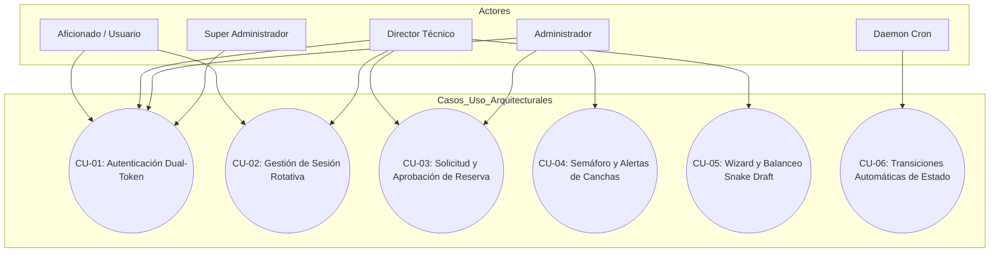
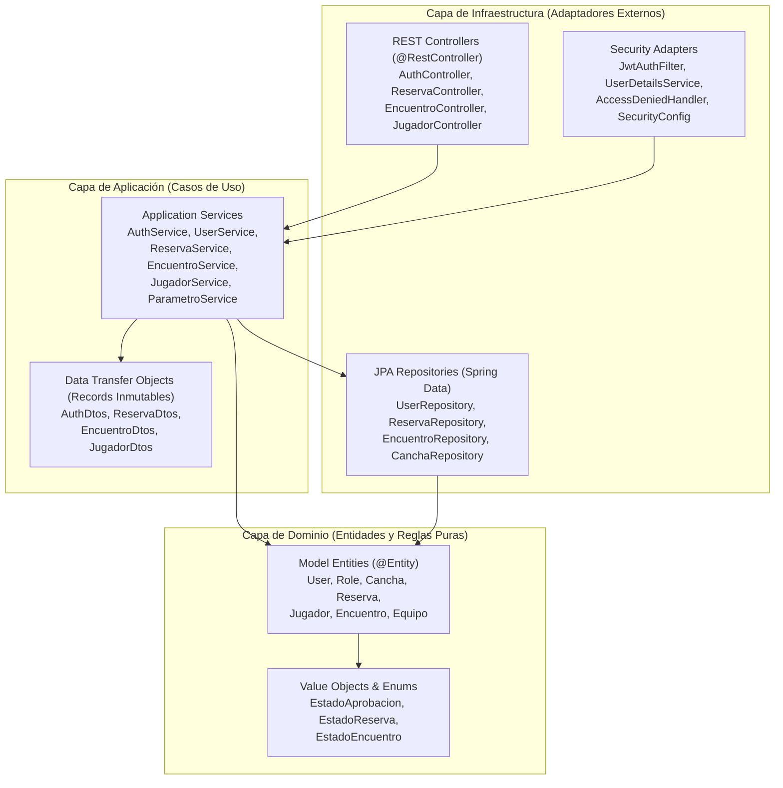
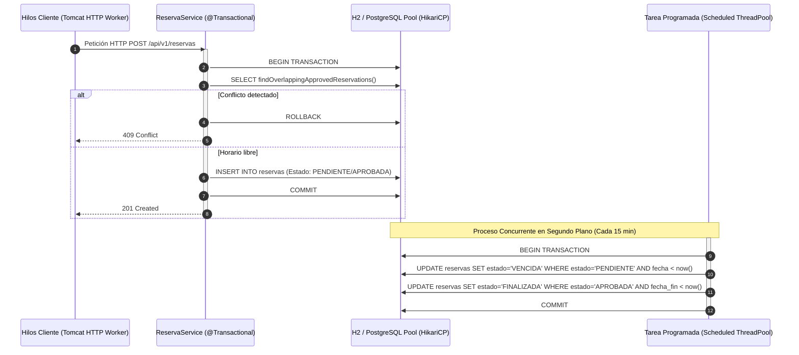
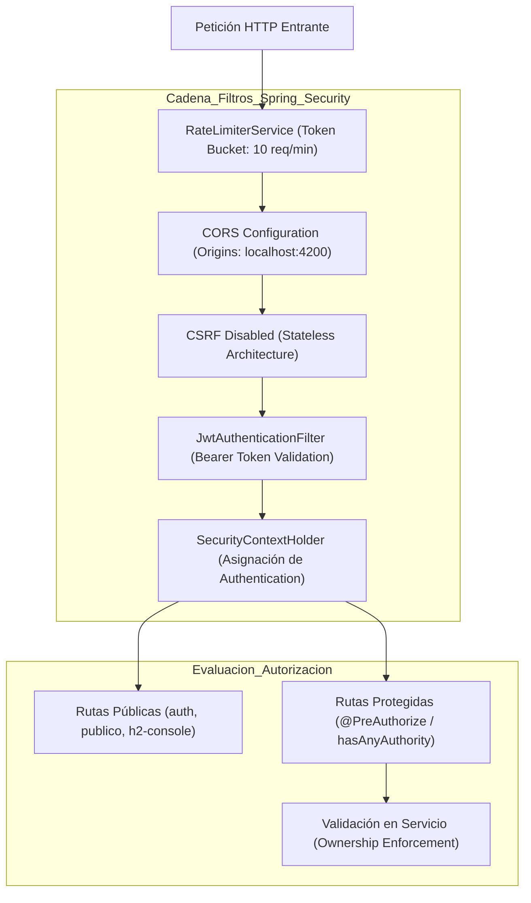

# Documento de Arquitectura de Software (SAD) — Vistas 4+1
## Metodología RUP — Fase de Elaboración (Elaboration)

**Proyecto:** Plataforma Integral de Gestión Deportiva y Autenticación ("FUTBOL S.A.")  
**Metodología:** RUP (Modelo 4+1 Vistas de Kruchten)  
**Versión:** 1.0.0  
**Fecha:** 2026-11-24  

---

## 1. Introducción y Objetivos Arquitectónicos

El Documento de Arquitectura de Software (SAD) captura las decisiones de diseño estructurales más significativas del sistema para garantizar el cumplimiento de los requerimientos funcionales y los atributos de calidad (seguridad, rendimiento, escalabilidad, mantenibilidad y usabilidad).

### 1.1. Principios Arquitectónicos Rectores
1. **Clean Architecture / Separación de Preocupaciones:** Desacoplamiento estricto entre el Dominio puro, los Casos de Uso (Aplicación) y los Adaptadores de Infraestructura (Web, Persistencia, Seguridad).
2. **Seguridad en Profundidad (Defense in Depth):** Aplicación de seguridad perimetral (Rate Limiting), autenticación robusta dual-token (JWT en memoria + Cookie HTTPOnly rotativa), hashing BCrypt (costo 12), protección anti-enumeración de usuarios (*timing-safe*) y autorización defensiva Zero-Trust en cada endpoint.
3. **Stateless Backend:** El servidor backend no conserva estado de sesión en memoria HTTP (`SessionCreationPolicy.STATELESS`), permitiendo escalabilidad horizontal sin afinidad de sesiones.
4. **Zero-Knowledge Frontend:** Ningún hash, token de refresco sensible o secreto confidencial de la base de datos se transmite hacia el cliente Angular.

---

## 2. Vista de Casos de Uso (Escenarios Significativos)

La vista de casos de uso actúa como el eje central que guía y valida las demás vistas del modelo 4+1.



### Casos de Uso Clave:
- **CU-01 (Autenticación Dual-Token):** Emisión de credenciales seguras (Access Token 15 min + Refresh Token en cookie).
- **CU-02 (Gestión de Sesión Rotativa):** Rotación uno a uno de tokens y mitigación de Token Replay Attack.
- **CU-03 (Solicitud y Aprobación de Reserva):** Solicitud por horas enteras, cálculo de monto y verificación transaccional anti-cruces.
- **CU-04 (Semáforo y Alertas):** Categorización por inmediatez (Rojo/Ámbar/Verde) y notificación automática a las 08:00 AM.
- **CU-05 (Wizard y Balanceo Snake Draft):** Distribución equitativa de jugadores según calificación de estrellas.
- **CU-06 (Transiciones Automáticas Cron):** Procesamiento en segundo plano de reservas vencidas/finalizadas y partidos en juego.

---

## 3. Vista Lógica (Estructura de Capas y Paquetes)

El backend adopta una arquitectura en capas concéntricas (Clean Architecture) implementada sobre Spring Boot 3.3+:



### 3.1. Paquetes de Backend
- `com.empresa.seguridad.domain.model`: Modelos de identidad pura (`User`, `Role`, `Permission`, `RefreshToken`, `PasswordResetToken`, `SystemConfiguration`, `AuditLog`).
- `com.empresa.seguridad.application.service`: Lógica de autenticación, rate limiting y administración de identidades.
- `com.empresa.seguridad.infrastructure.security`: Filtro JWT en cadena `JwtAuthenticationFilter`, proveedor `JwtService` y manejadores de error de seguridad.
- `com.empresa.seguridad.encuentros.domain.model`: Entidades deportivas (`Cancha`, `Reserva`, `Jugador`, `JugadorHistorialEstrellas`, `Encuentro`, `Equipo`, `Parametro`, `Notificacion`).
- `com.empresa.seguridad.encuentros.application.service`: Lógica de reservas, validación de cruces horarios, algoritmo Snake Draft, tareas batch y archivos.
- `com.empresa.seguridad.encuentros.infrastructure.web`: Controladores REST desacoplados.

---

## 4. Vista de Procesos (Concurrencia, Hilos y Transacciones)



### Mecanismos de Proceso y Concurrencia:
1. **Pool de Hilos Web (Apache Tomcat Embebido):** Cada petición HTTP se procesa en un hilo dedicado administrado por el worker pool de Tomcat.
2. **Pool de Conexiones JDBC (HikariCP):** HikariPool-1 gestiona conexiones transaccionales reutilizables con soporte de transacciones ACID.
3. **Mecanismo `@Transactional` de Spring:** Todas las operaciones de mutación en servicios operan bajo aislamiento estándar. Si ocurre cualquier `RuntimeException`, el TransactionManager de Spring ejecuta un rollback automático inmediato.
4. **Hilos Daemon de Fondo (`ThreadPoolTaskScheduler`):** Tarea programada `@Scheduled(fixedRate = 900000)` para transiciones automáticas y `@Scheduled(cron = "0 0 8 * * ?")` para notificaciones matutinas del semáforo.
5. **Caché en Memoria L2 (Caffeine):** Control de acceso concorrente thread-safe (`ConcurrentHashMap`) con políticas de expiración a 30 minutos y desalojo reactivo (`@CacheEvict`) ante mutaciones.

---

## 5. Vista de Desarrollo / Implementación

### 5.1. Organización del Código Fuente
```
futbol1/
├── backend/                             # Módulo Backend Spring Boot 3.3
│   ├── pom.xml                          # Descriptor Maven y dependencias
│   └── src/main/java/com/empresa/seguridad/
│       ├── domain/                      # Entidades y Repositorios de Seguridad
│       ├── application/                 # DTOs y Servicios de Seguridad
│       ├── infrastructure/              # Configuración, Seguridad JWT y Web REST
│       └── encuentros/                  # Submódulo Encuentros y Canchas (Clean Arch)
│           ├── domain/                  # Entidades Deportivas
│           ├── application/             # Servicios de Negocio (Reserva, Encuentro, Jugador)
│           └── infrastructure/          # Controladores y Endpoints
├── frontend/                            # Módulo Frontend Angular 18+
│   ├── package.json                     # Dependencias NPM
│   └── src/app/
│       ├── core/                        # Servicios singleton, modelos, guards, interceptores
│       │   ├── guards/                  # auth.guard, role.guard
│       │   ├── interceptors/            # jwt.interceptor, error.interceptor
│       │   ├── layout/                  # main-layout.component (Sidebar, Header, Topbar)
│       │   ├── models/                  # auth.models, encuentros.models
│       │   └── services/                # auth.service, encuentros.service
│       └── features/                    # Módulos funcionales (Lazy Loading Standalone)
│           ├── admin/                   # Aprobación de técnicos
│           ├── auth/                    # Login, Registro, Recuperación de clave
│           ├── config/                  # Fijar tarifas de cancha, parámetros
│           ├── dashboard/               # Métricas y KPIs ejecutivos
│           ├── encuentros/              # Calendario, Reservas, Semáforos, Jugadores, Wizard
│           ├── profile/                 # Mi perfil, cambio de foto y clave
│           └── public/                  # Home, cartelera pública de encuentros
├── docs/                                # Documentación de lógica y auditoría
└── RUP/                                 # Documentación de Ingeniería de Software RUP
```

### 5.2. Pila Tecnológica Homologada
- **Backend:** Java 17 LTS (Amazon Corretto), Spring Boot 3.3+, Spring Data JPA, Spring Security 6, Hibernate 6, Lombok, MapStruct, Caffeine Cache.
- **Frontend:** Node.js, Angular 18+ Standalone, TypeScript 5+, Angular Material 18, RxJS 7, SweetAlert2.
- **Persistencia y Datos:** H2 Database Engine 2.3+ en memoria (`DB_CLOSE_DELAY=-1`) con dialecto PostgreSQL, Hibernate DDL Auto.

---

## 6. Vista Física / Despliegue

La vista física describe la topología de red, servidores y recursos de cómputo donde se ejecuta el sistema:

```mermaid
graph LR
    subgraph Cliente_Navegador ["Dispositivos Cliente (Desktop / Mobile)"]
        Browser["Navegador Web (Chrome / Edge / Firefox)<br>SPA Angular 18 (HTML5 / SCSS / JS)<br>Memory Token Store"]
    end

    subgraph Servidor_Aplicacion ["Servidor de Aplicación (Host Local / Cloud Node)"]
        direction TB
        subgraph Front_Server ["Web Server Frontend (Puerto 4200)"]
            AngularSvr["Node.js / Angular Dev Server<br>o NGINX Reverse Proxy"]
        end
        
        subgraph Back_Server ["API Gateway & Backend (Puerto 8080)"]
            TomcatSvr["Spring Boot Embedded Tomcat<br>DispatcherServlet & Spring Security"]
        end
        
        subgraph Persistencia_Local ["Persistencia & Almacenamiento"]
            H2DB["H2 In-Memory DB Engine<br>jdbc:h2:mem:seguridad_db"]
            DiskStorage["Sistema de Archivos Local<br>uploads/ (comprobantes, jugadores, banners, avatars)"]
        end
    end

    Browser -->|HTTP:4200 (Assets SPA)| AngularSvr
    Browser -->|REST API HTTP:8080 (JSON / Multipart)| TomcatSvr
    TomcatSvr -->|JDBC Connection Pool| H2DB
    TomcatSvr -->|File I/O (NIO Paths)| DiskStorage
```

### 6.1. Puertos y Canales de Comunicación
- **Puerto 4200:** Acceso a la interfaz web Angular para usuarios y administradores.
- **Puerto 8080:** Acceso a la API REST del backend (`http://localhost:8080/api/v1/*`) y consola H2 (`http://localhost:8080/h2-console`).
- **Canal de Archivos:** Carpeta raíz normalizada `uploads/` accesible mediante el endpoint público seguro `/api/v1/publico/archivos/{folder}/{filename}`.

---

## 7. Arquitectura de Seguridad (Cross-Cutting Concern)



### Principios de Seguridad Implementados:
1. **Validación Token Bearer en cada Request:** El filtro `JwtAuthenticationFilter` intercepta cada petición protegida, valida la firma criptográfica HMAC-SHA256 y la vigencia temporal del JWT, e inyecta el `UsernamePasswordAuthenticationToken` en el contexto de Spring Security.
2. **Defensa en Profundidad de Archivos:** Las fotos de jugadores, banners y avatares son accesibles públicamente para renderizado web, mientras que los comprobantes bancarios (`comprobantes/`) permanecen vedados a consultas anónimas y restringidos exclusivamente a personal administrativo.
