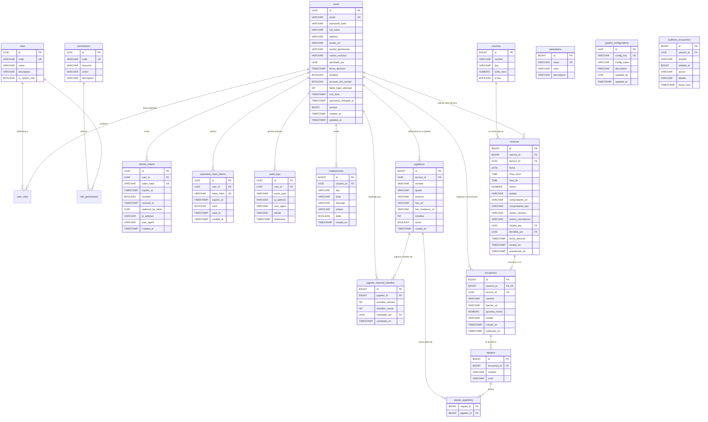

# Modelo de Datos y Diccionario de Base de Datos
## Metodología RUP — Fase de Elaboración (Elaboration)

**Proyecto:** Plataforma Integral de Gestión Deportiva ("FUTBOL S.A.")  
**Metodología:** RUP (Disciplina de Análisis y Diseño de Datos)  
**Motor de Persistencia:** H2 Database Engine 2.3+ (Modo PostgreSQL) / PostgreSQL 15+  
**Versión:** 1.0.0  
**Fecha:** 2026-11-24  

---

## 1. Diagrama Entidad-Relación Global (ERD)

---

## 2. Diccionario de Datos Exhaustivo

### 2.1. Tabla: `users`
Almacena las cuentas de usuario y directores técnicos, credenciales cifradas y estados de bloqueo.

| Columna | Tipo de Dato | Nulo | Clave / Restricción | Descripción Funcional |
| :--- | :--- | :---: | :---: | :--- |
| `id` | `UUID` | No | **PK** | Identificador universal único de usuario. |
| `email` | `VARCHAR(150)` | No | **UK** (`idx_users_email`) | Correo electrónico institucional o personal, normalizado en minúsculas. |
| `password_hash` | `VARCHAR(255)` | No | — | Hash irreversible de la contraseña generado con BCrypt (factor 12). |
| `full_name` | `VARCHAR(120)` | No | — | Nombre completo o razón social del usuario/técnico. |
| `telefono` | `VARCHAR(30)` | Sí | — | Número de contacto telefónico del usuario. |
| `avatar_url` | `VARCHAR(1000)` | Sí | — | Ruta relativa o URL pública de la foto de perfil del usuario. |
| `estado_aprobacion` | `VARCHAR(20)` | No | Default: `'ACTIVO'` | Estado administrativo (`PENDIENTE`, `ACTIVO`, `RECHAZADO`, `SUSPENDIDO`). |
| `motivo_rechazo` | `VARCHAR(500)` | Sí | — | Justificación obligatoria en caso de rechazo del técnico ($\ge 10$ caracteres). |
| `aprobado_por` | `UUID` | Sí | — | ID del administrador que aprobó o rechazó la cuenta. |
| `fecha_decision` | `TIMESTAMP` | Sí | — | Fecha y hora en la que se tomó la decisión sobre el expediente. |
| `enabled` | `BOOLEAN` | No | Default: `true` | Bandera de activación general de la cuenta. |
| `account_non_locked` | `BOOLEAN` | No | Default: `true` | Bandera de bloqueo por fuerza bruta (`false` si acumuló 5 intentos fallidos). |
| `failed_login_attempts`| `INT` | No | Default: `0` | Contador de fallos de contraseña consecutivos. |
| `lock_time` | `TIMESTAMP` | Sí | — | Marca temporal del momento en que se bloqueó la cuenta. |
| `password_changed_at` | `TIMESTAMP` | Sí | — | Fecha de la última modificación de contraseña. |
| `version` | `BIGINT` | No | Optimistic Lock | Versión para control de concurrencia optimista de JPA. |
| `created_at` | `TIMESTAMP` | No | — | Fecha y hora de creación del registro. |
| `updated_at` | `TIMESTAMP` | No | — | Fecha y hora de última actualización del registro. |

---

### 2.2. Tablas RBAC: `roles`, `permissions`, `user_roles`, `role_permissions`

#### Tabla: `roles`
| Columna | Tipo de Dato | Nulo | Clave | Descripción Funcional |
| :--- | :--- | :---: | :---: | :--- |
| `id` | `UUID` | No | **PK** | Identificador único del rol. |
| `code` | `VARCHAR(50)` | No | **UK** | Código canónico (`ROLE_SUPER_ADMIN`, `ROLE_ADMIN`, `ROLE_TECNICO`, `ROLE_USER`). |
| `name` | `VARCHAR(100)` | No | — | Nombre descriptivo del rol. |
| `description` | `VARCHAR(255)` | Sí | — | Alcance funcional del rol. |
| `is_system_role` | `BOOLEAN` | No | — | Si es `true`, es un rol protegido del sistema y no puede eliminarse. |

#### Tabla: `permissions`
| Columna | Tipo de Dato | Nulo | Clave | Descripción Funcional |
| :--- | :--- | :---: | :---: | :--- |
| `id` | `UUID` | No | **PK** | Identificador único del permiso. |
| `code` | `VARCHAR(50)` | No | **UK** | Código del permiso (ej. `USER_CREATE`, `RESERVA_APPROVE`). |
| `resource` | `VARCHAR(50)` | No | — | Entidad o recurso protegido (`USER`, `RESERVA`, `CONFIG`). |
| `action` | `VARCHAR(50)` | No | — | Acción autorizada (`CREATE`, `READ`, `UPDATE`, `DELETE`). |
| `description` | `VARCHAR(255)` | Sí | — | Explicación del permiso. |

#### Tabla Intermedia: `user_roles`
| Columna | Tipo de Dato | Nulo | Clave | Descripción |
| :--- | :--- | :---: | :---: | :--- |
| `user_id` | `UUID` | No | **FK** $\rightarrow$ `users(id)` | Usuario asociado. |
| `role_id` | `UUID` | No | **FK** $\rightarrow$ `roles(id)` | Rol concedido. |

#### Tabla Intermedia: `role_permissions`
| Columna | Tipo de Dato | Nulo | Clave | Descripción |
| :--- | :--- | :---: | :---: | :--- |
| `role_id` | `UUID` | No | **FK** $\rightarrow$ `roles(id)` | Rol. |
| `permission_id` | `UUID` | No | **FK** $\rightarrow$ `permissions(id)` | Permiso otorgado al rol. |

---

### 2.3. Tabla: `refresh_tokens`
Gobierna las sesiones activas, la rotación de tokens y la mitigación de ataques de repetición.

| Columna | Tipo de Dato | Nulo | Clave | Descripción Funcional |
| :--- | :--- | :---: | :---: | :--- |
| `id` | `UUID` | No | **PK** | Identificador del token de refresco. |
| `user_id` | `UUID` | No | **FK** $\rightarrow$ `users(id)` | Usuario propietario de la sesión. |
| `token_hash` | `VARCHAR(255)` | No | **UK** | Hash SHA-256 del token plano entregado al cliente. |
| `expires_at` | `TIMESTAMP` | No | — | Fecha y hora de caducidad (7 días). |
| `revoked` | `BOOLEAN` | No | Default: `false` | Indica si el token fue invalidado por logout, rotación o sospecha de robo. |
| `revoked_at` | `TIMESTAMP` | Sí | — | Momento exacto de revocación. |
| `replaced_by_token`| `UUID` | Sí | — | ID del nuevo token que reemplazó a este en la rotación. |
| `ip_address` | `VARCHAR(45)` | Sí | — | Dirección IP del cliente en la emisión. |
| `user_agent` | `VARCHAR(255)` | Sí | — | Cabecera User-Agent del navegador cliente. |
| `created_at` | `TIMESTAMP` | No | — | Momento de generación del token. |

---

### 2.4. Tabla: `canchas`
Catálogo de canchas deportivas e infraestructura del complejo.

| Columna | Tipo de Dato | Nulo | Clave | Descripción Funcional |
| :--- | :--- | :---: | :---: | :--- |
| `id` | `BIGINT` | No | **PK** (Auto-increment) | Identificador único de la cancha. |
| `nombre` | `VARCHAR(100)` | No | — | Nombre público (ej. "Cancha 1", "Cancha Central"). |
| `tipo` | `VARCHAR(50)` | No | — | Capacidad de juego (`Fútbol 5`, `Fútbol 7`, `Fútbol 11`). |
| `tarifa_hora` | `NUMERIC(10,2)` | No | Check: $> 0$ | Precio por hora de uso en Soles (PEN). |
| `activa` | `BOOLEAN` | No | Default: `true` | Disponibilidad operativa para admitir reservas. |

---

### 2.5. Tabla: `reservas`
Entidad transaccional central para la programación de horarios en canchas.

| Columna | Tipo de Dato | Nulo | Clave / Restricción | Descripción Funcional |
| :--- | :--- | :---: | :---: | :--- |
| `id` | `BIGINT` | No | **PK** (Auto-increment) | Identificador de la reserva. |
| `cancha_id` | `BIGINT` | No | **FK** $\rightarrow$ `canchas(id)` | Cancha deportiva solicitada. |
| `tecnico_id` | `UUID` | No | **FK** $\rightarrow$ `users(id)` | Director Técnico solicitante / titular. |
| `fecha` | `DATE` | No | — | Día programado para el alquiler de la cancha. |
| `hora_inicio` | `TIME` | No | — | Hora de inicio (minutos `:00`). |
| `hora_fin` | `TIME` | No | — | Hora de finalización (minutos `:00` o `23:59`). |
| `monto` | `NUMERIC(10,2)` | No | — | Importe total liquidado ($\text{horas} \times \text{tarifa}$). |
| `estado` | `VARCHAR(20)` | No | Enum String | `PENDIENTE`, `APROBADA`, `RECHAZADA`, `CANCELADA`, `VENCIDA`, `FINALIZADA`. |
| `comprobante_url` | `VARCHAR(500)` | Sí | — | Ruta relativa del voucher en `uploads/comprobantes/`. |
| `comprobante_tipo`| `VARCHAR(50)` | Sí | — | MIME type (`image/png`, `image/jpeg`, `application/pdf`). |
| `motivo_rechazo` | `VARCHAR(500)` | Sí | — | Razón formal de desestimación de la reserva. |
| `motivo_cancelacion`| `VARCHAR(500)`| Sí | — | Razón de la anulación ingresada por el técnico o admin. |
| `creada_por` | `UUID` | Sí | **FK** $\rightarrow$ `users(id)` | Usuario creador de la transacción. |
| `decidida_por` | `UUID` | Sí | **FK** $\rightarrow$ `users(id)` | Administrador que aprobó o rechazó. |
| `fecha_decision` | `TIMESTAMP` | Sí | — | Fecha y hora de la decisión administrativa. |
| `creada_en` | `TIMESTAMP` | No | — | Fecha y hora de inserción del registro. |
| `actualizada_en` | `TIMESTAMP` | No | — | Fecha y hora de última modificación. |

---

### 2.6. Tabla: `jugadores`
Plantel de futbolistas gestionados por cada Director Técnico.

| Columna | Tipo de Dato | Nulo | Clave | Descripción Funcional |
| :--- | :--- | :---: | :---: | :--- |
| `id` | `BIGINT` | No | **PK** (Auto-increment) | Identificador único del jugador. |
| `tecnico_id` | `UUID` | No | **FK** $\rightarrow$ `users(id)` | Técnico propietario del jugador en su nómina. |
| `nombre` | `VARCHAR(100)` | No | — | Nombres y apellidos del futbolista. |
| `apodo` | `VARCHAR(100)` | Sí | — | Sobrenombre o alias deportivo. |
| `posicion` | `VARCHAR(50)` | Sí | — | Posición táctica en cancha (delantero, defensa, etc.). |
| `foto_url` | `VARCHAR(500)` | Sí | — | Ruta relativa de la foto en `uploads/jugadores/`. |
| `foto_miniatura_url`| `VARCHAR(500)`| Sí | — | Ruta de imagen miniatura optimizada. |
| `estrellas` | `INT` | No | Check: $[1, 5]$ | Puntuación de habilidad y condición física ($1 \dots 5$). |
| `activo` | `BOOLEAN` | No | Default: `true` | Indicador de baja lógica (`false` = inactivo). |
| `creado_en` | `TIMESTAMP` | No | — | Fecha de inscripción del jugador. |

---

### 2.7. Tabla: `jugador_historial_estrellas`
Auditoría inmutable de calificaciones deportivas.

| Columna | Tipo de Dato | Nulo | Clave | Descripción Funcional |
| :--- | :--- | :---: | :---: | :--- |
| `id` | `BIGINT` | No | **PK** (Auto-increment) | Identificador del registro histórico. |
| `jugador_id` | `BIGINT` | No | **FK** $\rightarrow$ `jugadores(id)` | Jugador evaluado. |
| `estrellas_anterior`| `INT` | No | — | Calificación que poseía antes de la edición ($1 \dots 5$). |
| `estrellas_nueva` | `INT` | No | — | Nueva calificación asignada ($1 \dots 5$). |
| `cambiado_por` | `UUID` | No | **FK** $\rightarrow$ `users(id)` | Usuario autor de la modificación. |
| `cambiado_en` | `TIMESTAMP` | No | — | Fecha y hora exacta de la recalificación. |

---

### 2.8. Tablas de Encuentros y Convocatorias: `encuentros`, `equipos`, `equipo_jugadores`

#### Tabla: `encuentros`
| Columna | Tipo de Dato | Nulo | Clave | Descripción Funcional |
| :--- | :--- | :---: | :---: | :--- |
| `id` | `BIGINT` | No | **PK** (Auto-increment) | Identificador del encuentro. |
| `reserva_id` | `BIGINT` | No | **FK**, **UK** $\rightarrow$ `reservas(id)` | Reserva base aprobada (relación 1 a 1 obligatoria). |
| `tecnico_id` | `UUID` | No | **FK** $\rightarrow$ `users(id)` | Técnico organizador del partido. |
| `nombre` | `VARCHAR(150)` | No | — | Nombre del partido (ej. "Torneo Relámpago"). |
| `banner_url` | `VARCHAR(500)` | Sí | — | Imagen publicitaria en `uploads/banners/`. |
| `apuesta_monto` | `NUMERIC(10,2)` | Sí | Check: $> 0$ | Pozo o apuesta deportiva acordada (opcional). |
| `estado` | `VARCHAR(20)` | No | Enum String | `BORRADOR`, `PUBLICADO`, `EN_JUEGO`, `FINALIZADO`, `CANCELADO`. |
| `creado_en` | `TIMESTAMP` | No | — | Momento de creación del borrador. |
| `publicado_en` | `TIMESTAMP` | Sí | — | Momento en que se hizo público en cartelera. |

#### Tabla: `equipos`
| Columna | Tipo de Dato | Nulo | Clave | Descripción Funcional |
| :--- | :--- | :---: | :---: | :--- |
| `id` | `BIGINT` | No | **PK** (Auto-increment) | Identificador del equipo. |
| `encuentro_id` | `BIGINT` | No | **FK** $\rightarrow$ `encuentros(id)` | Encuentro al que pertenece el equipo. |
| `nombre` | `VARCHAR(100)` | No | — | Nombre del bando (ej. "Equipo 1", "Los Rayos"). |
| `color` | `VARCHAR(20)` | No | — | Color distintivo de camiseta en hexadecimal (ej. `#0066FF`). |

#### Tabla Intermedia: `equipo_jugadores`
| Columna | Tipo de Dato | Nulo | Clave | Descripción |
| :--- | :--- | :---: | :---: | :--- |
| `equipo_id` | `BIGINT` | No | **FK** $\rightarrow$ `equipos(id)` | Equipo. |
| `jugador_id` | `BIGINT` | No | **FK** $\rightarrow$ `jugadores(id)` | Jugador alineado en ese equipo. |

---

### 2.9. Tablas Transversales: `notificaciones`, `parametros`, `auditoria_encuentros`

#### Tabla: `notificaciones`
| Columna | Tipo de Dato | Nulo | Clave | Descripción Funcional |
| :--- | :--- | :---: | :---: | :--- |
| `id` | `BIGINT` | No | **PK** (Auto-increment) | Identificador de la notificación. |
| `usuario_id` | `UUID` | No | **FK** $\rightarrow$ `users(id)` | Destinatario del aviso. |
| `tipo` | `VARCHAR(50)` | No | — | Código del evento (`RESERVA_APROBADA`, `NUEVA_RESERVA`, etc.). |
| `titulo` | `VARCHAR(150)` | No | — | Encabezado conciso de la notificación. |
| `mensaje` | `VARCHAR(500)` | No | — | Cuerpo descriptivo del mensaje. |
| `enlace` | `VARCHAR(255)` | Sí | — | Ruta relativa en la SPA para navegación directa al hacer clic. |
| `leida` | `BOOLEAN` | No | Default: `false` | Estado de lectura por el usuario. |
| `creada_en` | `TIMESTAMP` | No | — | Fecha y hora de despacho. |

#### Tabla: `parametros`
| Columna | Tipo de Dato | Nulo | Clave | Descripción Funcional |
| :--- | :--- | :---: | :---: | :--- |
| `id` | `BIGINT` | No | **PK** (Auto-increment) | Identificador del parámetro. |
| `clave` | `VARCHAR(100)` | No | **UK** | Nombre único (`EQUIPO_MIN_JUGADORES`, `ALERTA_ROJO_DIAS`). |
| `valor` | `VARCHAR(500)` | No | — | Valor configurado como texto convertible. |
| `descripcion` | `VARCHAR(255)` | Sí | — | Propósito y efecto de la regla en el negocio. |

#### Tabla: `auditoria_encuentros`
| Columna | Tipo de Dato | Nulo | Clave | Descripción Funcional |
| :--- | :--- | :---: | :---: | :--- |
| `id` | `BIGINT` | No | **PK** (Auto-increment) | Identificador de la traza de auditoría. |
| `usuario_id` | `UUID` | Sí | **FK** $\rightarrow$ `users(id)` | Usuario ejecutor de la operación (null si es el sistema). |
| `entidad` | `VARCHAR(50)` | No | — | Entidad afectada (`RESERVA`, `ENCUENTRO`, `JUGADOR`, `USUARIO_TECNICO`). |
| `entidad_id` | `BIGINT` | No | — | ID numérico del registro afectado. |
| `accion` | `VARCHAR(50)` | No | — | Acción (`APROBAR_RESERVA`, `CREAR_JUGADOR`, etc.). |
| `detalle` | `VARCHAR(500)` | Sí | — | Bitácora textual de los cambios aplicados. |
| `fecha_hora` | `TIMESTAMP` | No | — | Timestamp inmutable de la operación. |
