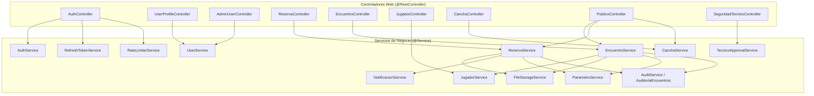

# Especificación Técnica de Componentes de Software
## Metodología RUP — Fase de Construcción (Construction)

**Proyecto:** Plataforma Integral de Gestión Deportiva ("FUTBOL S.A.")  
**Metodología:** RUP (Disciplina de Implementación y Diseño de Componentes)  
**Versión:** 1.0.0  
**Fecha:** 2026-11-24  

---

## 1. Arquitectura y Catálogo de Componentes Backend (Spring Boot 3.3)

El backend está compuesto por controladores desacoplados, servicios de aplicación transaccionales, adaptadores de seguridad y repositorios de datos.



### 1.1. Controladores REST (`infrastructure.web`)

| Componente Controlador | Endpoint Base | Responsabilidad Funcional |
| :--- | :--- | :--- |
| **`AuthController`** | `/api/v1/auth` | Login con credenciales, registro público, registro técnico, rotación de refresh tokens, logout seguro, solicitud de recuperación y reseteo de claves. |
| **`UserProfileController`** | `/api/v1/profile` | Consulta del perfil autenticado (`/me`), cambio personal de contraseña con validación de clave actual, subida y eliminación de foto de avatar. |
| **`AdminUserController`** | `/api/v1/admin/users` | Listado paginado de usuarios, alta administrativa, actualización de roles, desactivación en lote (`batch-status`) y reseteo forzado de claves. |
| **`AdminConfigController`** | `/api/v1/admin/config` | Modificación de parámetros del sistema y variables de entorno dinámicas. |
| **`AdminReportController`** | `/api/v1/admin/reports` | Métricas ejecutivas de actividad, KPIs de usuarios y consulta forense de bitácoras de auditoría (`audit_logs`). |
| **`ReservaController`** | `/api/v1/reservas` | Creación de reservas por técnico/admin, aprobación con bloqueo anti-cruces, rechazo justificado, cancelación con ventana de 24h, reprogramación y semáforos. |
| **`EncuentroController`** | `/api/v1/encuentros` | Creación de borrador de partido, actualización de alineaciones, balanceo automático Snake Draft, publicación en cartelera comunitaria y cancelación. |
| **`JugadorController`** | `/api/v1/jugadores` | Alta de jugadores en el plantel, edición de posición y estrellas con auditoría histórica, baja lógica y consulta de historial de rendimiento. |
| **`CanchaController`** | `/api/v1/canchas` | Catálogo de canchas deportivas activas y actualización de tarifas por hora por parte de administradores. |
| **`PublicoController`** | `/api/v1/publico` | Endpoints anónimos para consultar partidos en cartelera (`/encuentros`), disponibilidad horaria de canchas (`/disponibilidad`) y descarga de imágenes públicas (`/archivos/{folder}/{filename}`). |
| **`SeguridadTecnicoController`** | `/api/v1/admin/tecnicos` | Bandeja administrativa para aprobar, rechazar, suspender o reactivar expedientes de Directores Técnicos. |

---

### 1.2. Servicios de Aplicación (`application.service`)

| Servicio | Anotaciones Clave | Responsabilidad y Mecanismos de Diseño |
| :--- | :--- | :--- |
| **`AuthService`** | `@Service`, `@Transactional` | Orquesta la autenticación contra Spring Security, invoca `RateLimiterService`, computa bloqueo defensivo tras 5 fallos, emite tokens duales y ejecuta lógica timing-safe en recuperación de claves. |
| **`ReservaService`** | `@Service`, `@Transactional` | Núcleo de reservas deportivas. Ejecuta `findOverlappingApprovedReservations` para consistencia horaria, valida horas enteras (1-24h), calcula importes por tarifa, gestiona semáforos (Rojo/Ámbar/Verde) y cancelaciones en cascada. |
| **`EncuentroService`** | `@Service`, `@Transactional` | Orquesta el wizard de partidos. Implementa el algoritmo determinístico Snake Draft ($A \rightarrow B \rightarrow B \rightarrow A$), valida restricciones de 4 a 8 jugadores por equipo y ventana de edición límite de 2 horas. |
| **`JugadorService`** | `@Service`, `@Transactional` | Administra nómina de jugadores. Inserta registros inmutables en `JugadorHistorialEstrellas` ante variaciones de nivel y garantiza la baja lógica (`activo = false`). |
| **`TecnicoApprovalService`**| `@Service`, `@Transactional` | Modifica `EstadoAprobacion` de técnicos, valida motivos de rechazo $\ge 10$ caracteres y genera notificaciones internas push. |
| **`RateLimiterService`** | `@Service` | Algoritmo Token Bucket en memoria volátil (`ConcurrentHashMap`) con limpieza automática periódica para limitar a 10 req/min por IP. |
| **`FileStorageService`** | `@Service` | Normaliza rutas seguras en disco local (`uploads/comprobantes`, `uploads/jugadores`, `uploads/banners`, `uploads/avatars`), genera UUIDs y valida extensiones y límites de tamaño. |
| **`EncuentrosScheduledTasks`**| `@Component`, `@Scheduled`| Tarea programada cada 15 min para transicionar reservas a `VENCIDA` o `FINALIZADA` y encuentros a `EN_JUEGO`/`FINALIZADO`. Tarea matutina diaria (08:00 Lima) para despachar alertas rojas a administradores. |

---

## 2. Arquitectura y Componentes Frontend (Angular 18+ Standalone)

El frontend sigue un enfoque 100% reactivo basado en Angular Signals, Standalone Components (sin módulos NgModule obsoletos) y carga perezosa (*Lazy Loading*).

```mermaid
graph TD
    subgraph Core_Architecture ["Arquitectura Núcleo (Core)"]
        AppRoutes[app.routes.ts]
        AuthGuard[auth.guard.ts]
        RoleGuard[role.guard.ts]
        JwtInterceptor[jwt.interceptor.ts]
        AuthSvcFront[auth.service.ts (Signals Store)]
        EncuentrosSvcFront[encuentros.service.ts]
        MainLayout[main-layout.component.ts]
    end

    subgraph Feature_Views ["Vistas y Componentes Funcionales"]
        HomeView[home.component.ts]
        LoginView[login.component.ts]
        ProfileView[profile.component.ts]
        ReservasCalView[reservas-calendario.component.ts]
        SolicitudesAdminView[solicitudes-admin.component.ts]
        AlertasView[alertas-semaforo.component.ts]
        WizardView[encuentro-wizard.component.ts]
        JugadoresView[jugadores.component.ts]
        ConfigView[config.component.ts]
    end

    AppRoutes --> AuthGuard
    AppRoutes --> RoleGuard
    AuthGuard --> AuthSvcFront
    RoleGuard --> AuthSvcFront
    MainLayout --> AuthSvcFront
    MainLayout --> EncuentrosSvcFront
    
    Feature_Views --> AuthSvcFront
    Feature_Views --> EncuentrosSvcFront
```

### 2.1. Gestión de Estado con Angular Signals (`auth.service.ts`)
El servicio `AuthService` en Angular centraliza el estado de identidad en señales reactivas inmutables:
- `currentUser = signal<UserSummary | null>(storedUser)`: Contiene datos del usuario, avatar, roles y permisos.
- `accessToken = signal<string | null>(storedToken)`: Token JWT conservado en memoria volátil de JavaScript (protegido contra ataques XSS persistentes).
- `isAuthenticated = computed(() => !!this.accessToken() && !!this.currentUser())`: Señal derivada booleana de sesión activa.
- `userRoles = computed(() => this.currentUser()?.roles ?? [])`: Roles del usuario.
- `canAccessDashboard = computed(() => this.isSuperAdmin() || this.isAdmin())`
- `canAccessConfig = computed(() => this.isSuperAdmin())`
- `canAccessEncuentrosMenu = computed(() => this.isSuperAdmin() || this.isAdmin() || this.isTecnico())`
- `canAccessProfile = computed(() => !this.isStandardUser())`

### 2.2. Interceptores y Seguridad HTTP
- **`JwtInterceptor`:** Captura cada llamada saliente hacia `http://localhost:8080/api/v1/` e inyecta la cabecera `Authorization: Bearer <accessToken>`. Habilita automáticamente `withCredentials: true` para el intercambio seguro de la cookie de refresh token.
- **`AuthGuard`:** Protege las rutas privadas verificando que `authService.isAuthenticated()` sea verdadero. Si el token expiró, redirige hacia `/auth/login`.
- **`RoleGuard`:** Evalúa si el usuario autenticado posee los roles declarados en la propiedad `data.roles` de la ruta. Si no cuenta con autorización, redirige a una vista segura o muestra denegación.

---

## 3. Especificación de Vistas y Componentes de Usuario

### 3.1. Componente: `ProfileComponent` (`/perfil`)
- **Diseño:** Tarjeta de dos paneles (Panel izquierdo: Avatar grande con iniciales o foto real, selector de archivo interactivo, botón "Cambiar Foto" y botón "Quitar Foto". Panel derecho: Formulario de actualización de nombre completo, correo y rol).
- **Mecanismos:** Vinculación a `<input type="file" accept="image/png, image/jpeg, image/webp">` oculto. Previsualización y subida inmediata con spinner animado `spin-animation` y alertas modales SweetAlert2.

### 3.2. Componente: `ConfigComponent` (`/configuracion`)
- **Diseño:** Panel administrativo de control de parámetros del sistema y **Sección Precio de la Cancha**.
- **Mecanismos:** Muestra tarjetas para Cancha 1 (F5), Cancha 2 (F7) y Cancha 3 (F11) con inputs numéricos formateados en Soles (`S/`) y botones "Fijar Precio" que invocan `PUT /api/v1/canchas/{id}/tarifa`.

### 3.3. Componente: `ReservasCalendarioComponent` (`/encuentros/reservas`)
- **Diseño:** Matriz visual y selector de reservas de canchas deportivas.
- **Mecanismos:** Modal reactivo "Solicitar Reserva de Cancha" con selectores de fecha, hora de inicio y hora de fin consecutivas (horas enteras de 08:00 a 24:00), cálculo dinámico de duración y costo estimado, y adjunto de voucher.

### 3.4. Componente: `AlertasSemaforoComponent` (`/encuentros/reservas/alertas`)
- **Diseño:** Tablero kanban/lista de solicitudes pendientes con tarjetas diferenciadas por colores semafóricos:
  - **Rojo:** $\le 2$ días de anticipación ("Vence hoy", "Vence en 1 día").
  - **Ámbar:** 3 días de anticipación.
  - **Verde:** $\ge 4$ días de anticipación ("Sin urgencia").
  - **Badge de Conflicto:** Indicador visual si la solicitud pendiente presenta solapamiento con otra reserva confirmada.

### 3.5. Componente: `EncuentroWizardComponent` (`/encuentros/eventos/nuevo`)
- **Diseño:** Asistente paso a paso (Paso 1: Datos de la reserva y nombre; Paso 2: Convocatoria de jugadores del plantel; Paso 3: Balanceo automático Snake Draft y previsualización de equipos; Paso 4: Confirmación y publicación).
- **Mecanismos:** Invocación del servicio `/balancear` que genera los equipos equilibrados con promedios de estrellas calculados y permite ajustes manuales antes de la publicación final.
