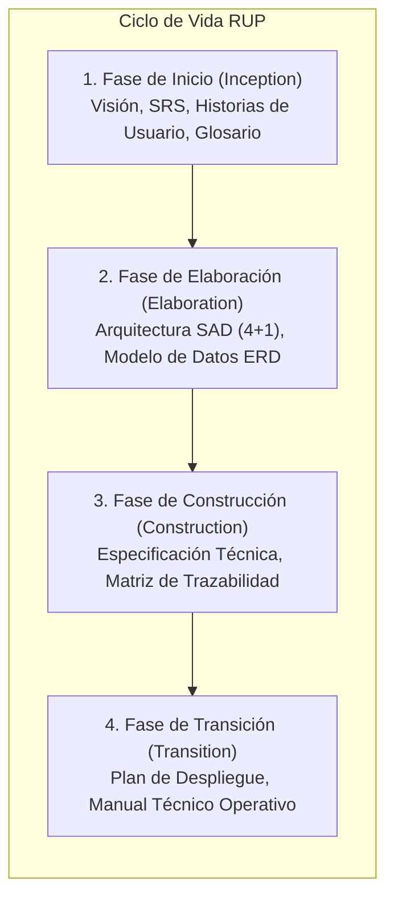

# Metodología RUP — Repositorio Maestro de Documentación
## Plataforma Integral de Gestión Deportiva, Reservas y Seguridad ("FUTBOL S.A.")

Bienvenido al repositorio maestro de documentación de ingeniería de software estructurado bajo la metodología **RUP (Rational Unified Process)**. Este cuerpo documental describe de forma exhaustiva la arquitectura, modelo de datos relacional, historias de usuario, reglas de negocio y planes de operación de todo el sistema.

---

## 1. Estructura Documental por Fases RUP

---

## 2. Índice y Mapa de Navegación de Entregables

### [Fase 1: Inicio (Inception)](file:///d:/MI_ESPACIO_IA/09/futbol1/RUP/01_Fase_Inicio/)
Define el caso de negocio, la delimitación del alcance, los stakeholders y los requisitos esenciales:
- 📄 **[01_vision_y_alcance.md](file:///d:/MI_ESPACIO_IA/09/futbol1/RUP/01_Fase_Inicio/01_vision_y_alcance.md):** Oportunidad de negocio, planteamiento del problema, matriz de actores/stakeholders, objetivos medibles del producto, alcance por módulos y requisitos no funcionales (Modelo FURPS+).
- 📄 **[02_historias_de_usuario_y_casos_de_uso.md](file:///d:/MI_ESPACIO_IA/09/futbol1/RUP/01_Fase_Inicio/02_historias_de_usuario_y_casos_de_uso.md):** 15 Historias de Usuario (HU-01 a HU-15) organizadas por épicas con criterios de aceptación en formato Given-When-Then (Gherkin), y especificación formal de los Casos de Uso centrales (CU-01 y CU-02) con diagramas de secuencia.
- 📄 **[03_glosario_y_reglas_negocio.md](file:///d:/MI_ESPACIO_IA/09/futbol1/RUP/01_Fase_Inicio/03_glosario_y_reglas_negocio.md):** Glosario de términos del dominio deportivo/empresarial y catálogo formal de 25 Reglas de Negocio (RN-SEC, RN-RES, RN-JUG, RN-ENC) numeradas y referenciables.

---

### [Fase 2: Elaboración (Elaboration)](file:///d:/MI_ESPACIO_IA/09/futbol1/RUP/02_Fase_Elaboracion/)
Establece la línea base de la arquitectura y la estructura de persistencia de datos:
- 📄 **[04_documento_arquitectura_software_sad.md](file:///d:/MI_ESPACIO_IA/09/futbol1/RUP/02_Fase_Elaboracion/04_documento_arquitectura_software_sad.md):** Software Architecture Document (SAD) completo bajo el modelo de **4+1 Vistas de Kruchten** (Vista de Casos de Uso, Vista Lógica en Clean Architecture, Vista de Procesos/Concurrencia, Vista de Implementación y Vista Física/Despliegue) con diagramas Mermaid y principios de seguridad Zero-Trust.
- 📄 **[05_modelo_datos_y_diccionario.md](file:///d:/MI_ESPACIO_IA/09/futbol1/RUP/02_Fase_Elaboracion/05_modelo_datos_y_diccionario.md):** Diagrama Entidad-Relación Global (ERD) en Mermaid y Diccionario de Datos riguroso de las 19 tablas relacionales (`users`, `roles`, `permissions`, `refresh_tokens`, `canchas`, `reservas`, `jugadores`, `jugador_historial_estrellas`, `encuentros`, `equipos`, `notificaciones`, `parametros`, `audit_logs`, etc.) con tipos de datos, constraints e índices.

---

### [Fase 3: Construcción (Construction)](file:///d:/MI_ESPACIO_IA/09/futbol1/RUP/03_Fase_Construccion/)
Detalla la implementación técnica y garantiza la trazabilidad sin vacíos:
- 📄 **[06_especificacion_tecnica_componentes.md](file:///d:/MI_ESPACIO_IA/09/futbol1/RUP/03_Fase_Construccion/06_especificacion_tecnica_componentes.md):** Catálogo de controladores REST, servicios de aplicación transaccionales (`@Transactional`), filtros de seguridad, tareas programadas (`@Scheduled`) y vistas frontend en Angular 18 Standalone con Angular Signals Store.
- 📄 **[07_matriz_trazabilidad_rup.md](file:///d:/MI_ESPACIO_IA/09/futbol1/RUP/03_Fase_Construccion/07_matriz_trazabilidad_rup.md):** Matriz integral end-to-end que mapea cada Requisito / Historia de Usuario con su Caso de Uso, Endpoint REST, Servicio Backend, Tablas de Base de Datos, Componente Frontend y Estado de Verificación (100% de cobertura).

---

### [Fase 4: Transición (Transition)](file:///d:/MI_ESPACIO_IA/09/futbol1/RUP/04_Fase_Transicion/)
Asegura la puesta en marcha exitosa, la operación continua y el soporte técnico:
- 📄 **[08_plan_despliegue_y_operaciones.md](file:///d:/MI_ESPACIO_IA/09/futbol1/RUP/04_Fase_Transicion/08_plan_despliegue_y_operaciones.md):** Requisitos de infraestructura (JDK 17, Node.js 18+, Maven 3.9+), configuración comentada de `application.yml`, guía de arranque de backend (8080) y frontend (4200), catálogo de cuentas semilla, estructura de carpetas `uploads/` y matriz de diagnóstico rápido de incidencias.

---

## 3. Resumen Técnico del Sistema

| Dimensión | Especificación Tecnológica Homologada |
| :--- | :--- |
| **Arquitectura de Software** | Clean Architecture / Capas desacopladas (Dominio puro, Aplicación, Infraestructura) |
| **Backend Framework** | Java 17 LTS, Spring Boot 3.3+, Spring Data JPA, Spring Security 6, Hibernate 6 |
| **Frontend Framework** | Angular 18+ Standalone, TypeScript 5+, Angular Material 18, Angular Signals Store |
| **Mecanismo de Seguridad** | Autenticación Dual-Token (JWT en memoria + Cookie HTTPOnly rotativa), BCrypt factor 12, Rate Limiting Token Bucket, Protección Timing-Safe |
| **Base de Datos** | H2 Database Engine 2.3+ en memoria (`jdbc:h2:mem:seguridad_db;MODE=PostgreSQL`) / Compatible PostgreSQL |
| **Almacenamiento de Archivos** | Sistema de archivos local normalizado (`uploads/avatars`, `uploads/banners`, `uploads/comprobantes`, `uploads/jugadores`) |
