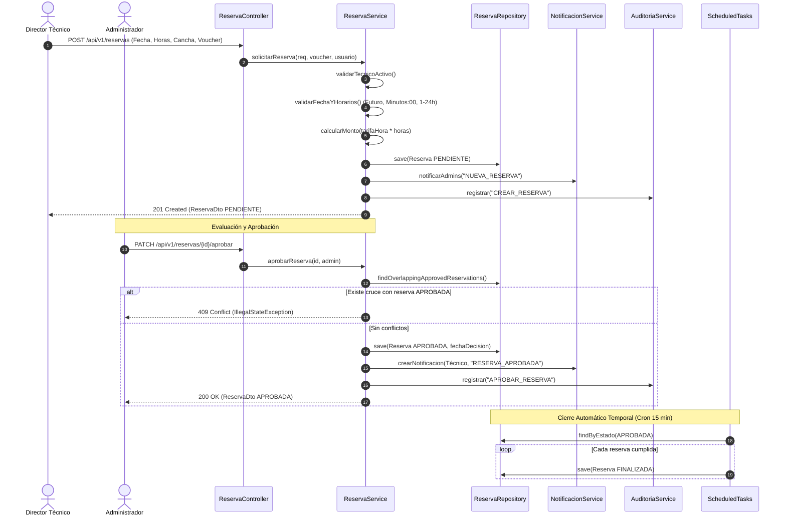
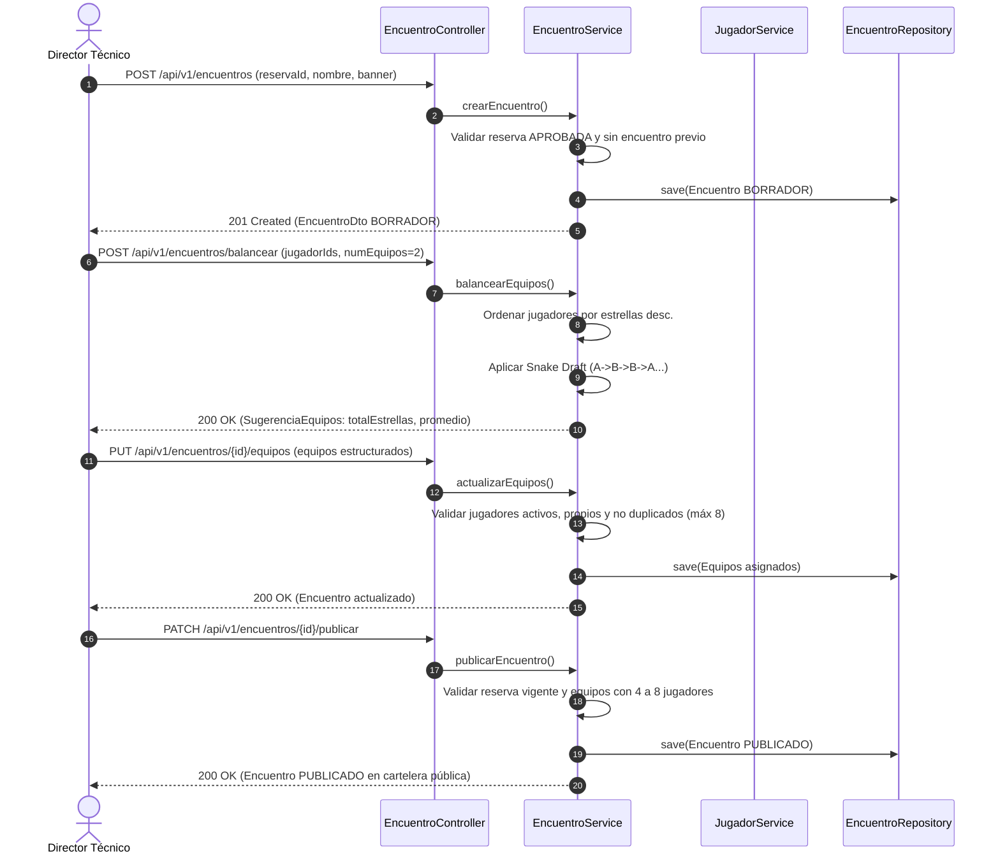
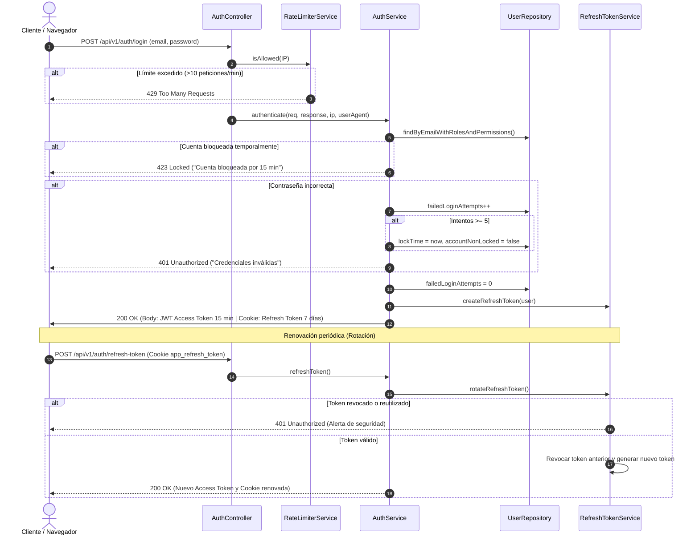
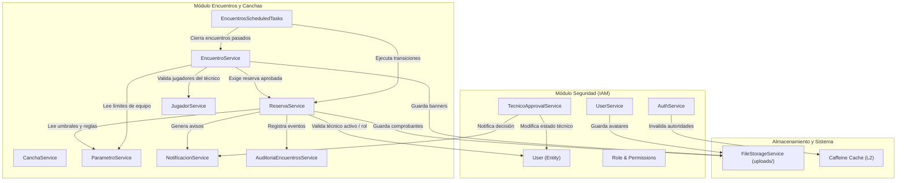

# Fase 1: Mapa General de Lógica del Sistema

**Proyecto:** Sistema de Gestión Deportiva y Autenticación ("FUTBOL S.A.")  
**Repositorio:** `d:\MI_ESPACIO_IA\09\futbol1`  
**Fecha de Análisis:** 2026-11-24  
**Alcance:** Exclusivamente lógica de negocio, validaciones, flujos de decisión, estados, transacciones y procesos de backend/base de datos.

---

## 1. Inventario de Procesos Lógicos

A continuación se detalla el inventario exhaustivo de todos los procesos de negocio implementados en el sistema, agrupados por módulo funcional y paquete de backend.

### 1.1. Módulo de Seguridad, Identidad y Control de Acceso (IAM)
*Paquete:* `com.empresa.seguridad`

| Proceso Lógico | Disparador / Invocación (Endpoint / Evento) | Componente Central / Método | Entidades / Tablas Afectadas | Descripción Funcional |
| :--- | :--- | :--- | :--- | :--- |
| **Autenticación Dual-Token** | `POST /api/v1/auth/login` | `AuthService.authenticate()` | `users`, `refresh_tokens`, `audit_logs` | Valida credenciales contra BCrypt (costo 12). Gestiona bloqueo por 5 intentos fallidos (15 min). Emite JWT Access Token en memoria y Refresh Token rotativo en cookie `HttpOnly; SameSite=Strict`. |
| **Rotación de Refresh Token** | `POST /api/v1/auth/refresh-token` | `AuthService.refreshToken()`, `RefreshTokenService.rotateRefreshToken()` | `refresh_tokens`, `users` | Detecta reutilización de tokens revocados (posible robo de sesión). Invalida token anterior y emite nuevo par sin reingresar contraseña. |
| **Cierre de Sesión Seguro** | `POST /api/v1/auth/logout` | `AuthService.logout()`, `RefreshTokenService.revokeToken()` | `refresh_tokens`, `audit_logs` | Revoca de forma inmediata el refresh token activo en base de datos y borra la cookie enviando `Max-Age=0`. |
| **Autorregistro Público** | `POST /api/v1/auth/register` | `AuthService.register()` | `users`, `user_roles`, `audit_logs`, `system_configurations` | Condicionado al parámetro `ALLOW_PUBLIC_REGISTRATION`. Si está activo, crea usuario con rol `ROLE_USER` y estado `ACTIVO`. |
| **Registro de Directores Técnicos** | `POST /api/v1/auth/registro-tecnico` | `AuthService.registerTecnico()` | `users`, `user_roles`, `audit_logs` | Registra un usuario con rol `ROLE_TECNICO` y estado de aprobación `PENDIENTE`. Requiere aprobación administrativa previa para operar. |
| **Solicitud de Recuperación de Clave** | `POST /api/v1/auth/forgot-password` | `AuthService.forgotPassword()` | `password_reset_tokens`, `audit_logs` | Genera token criptográfico temporal (15 min). Aplica protección anti-enumeración de usuarios (*timing-safe* mediante hash dummy) y envía correo. |
| **Restablecimiento de Contraseña** | `POST /api/v1/auth/reset-password` | `AuthService.resetPassword()` | `users`, `password_reset_tokens`, `refresh_tokens`, `audit_logs` | Valida token no expirado y no usado, actualiza hash de contraseña en `users`, invalida token y revoca todas las sesiones activas del usuario. |
| **Cambio de Contraseña Personal** | `POST /api/v1/profile/change-password` | `UserService.changePassword()` | `users`, `audit_logs` | Exige validación de la contraseña actual antes de computar y persistir el nuevo hash BCrypt. |
| **Actualización de Foto de Perfil** | `PUT /api/v1/profile/foto` | `UserService.updateProfilePhoto()` | `users`, archivo en `uploads/avatars/` | Valida formato de imagen (PNG/JPG/WEBP, máx 5MB), almacena en disco y actualiza columna `avatar_url` de `users`. |
| **Eliminación de Foto de Perfil** | `DELETE /api/v1/profile/foto` | `UserService.removeProfilePhoto()` | `users` | Establece `avatar_url = null` en la tabla `users` restableciendo el avatar por iniciales. |
| **Gestión Administrativa de Usuarios** | `POST /api/v1/admin/users`, `PUT /api/v1/admin/users/{id}` | `UserService.createUser()`, `UserService.updateUser()` | `users`, `user_roles`, `audit_logs` | Creación y actualización de cuentas internas, asignación de roles y activación/suspensión manual. |
| **Operaciones Batch de Usuarios** | `POST /api/v1/admin/users/batch-status`, `batch-roles` | `UserService.batchUpdateStatus()`, `batchAssignRoles()` | `users`, `user_roles` | Ejecución optimizada en base de datos mediante transacciones JPA por lotes (`updateStatusInBatch`). |
| **Reseteo Administrativo de Claves** | `POST /api/v1/admin/users/{id}/reset-password`, `/send-reset-link` | `UserService.adminResetPassword()`, `sendResetLink()` | `users`, `password_reset_tokens`, `refresh_tokens`, `audit_logs` | Generación de clave temporal o emisión forzada de enlace de recuperación, reseteando bloqueos y cerrando sesiones concurrentes. |
| **Aprobación / Rechazo de Técnicos** | `POST /api/v1/admin/tecnicos/{id}/aprobar`, `/rechazar` | `TecnicoApprovalService.aprobarTecnico()`, `rechazarTecnico()` | `users`, `notificaciones`, `auditoria_encuentros` | Transiciona estado del técnico (`PENDIENTE` $\rightarrow$ `ACTIVO` o `RECHAZADO`). El rechazo exige motivo $\ge 10$ caracteres. Genera notificación interna. |
| **Suspensión / Reactivación de Técnicos** | `POST /api/v1/admin/tecnicos/{id}/suspender`, `/reactivar` | `TecnicoApprovalService.suspenderTecnico()`, `reactivarTecnico()` | `users`, `auditoria_encuentros` | Modifica estado a `SUSPENDIDO` o `ACTIVO`, bloqueando o restituyendo sus facultades operativas. |
| **Limitación de Tasa (Rate Limiting)** | Interceptor / Servicio en cada autenticación | `RateLimiterService.isAllowed()` | Memoria volátil (`ConcurrentHashMap`) | Algoritmo Token Bucket en memoria con ventana de 1 minuto y límite de 10 peticiones/min por IP. |

---

### 1.2. Módulo de Canchas y Reservas Deportivas
*Paquete:* `com.empresa.seguridad.encuentros`

| Proceso Lógico | Disparador / Invocación (Endpoint / Evento) | Componente Central / Método | Entidades / Tablas Afectadas | Descripción Funcional |
| :--- | :--- | :--- | :--- | :--- |
| **Solicitud de Reserva de Cancha** | `POST /api/v1/reservas` | `ReservaService.solicitarReserva()` | `reservas`, `archivos (comprobantes)`, `notificaciones`, `auditoria_encuentros` | Valida técnico activo, horas enteras (08:00 a 24:00), duración (1 a 24 hrs), no pasado. Calcula monto = `tarifa_hora * horas`. Si es Técnico nace `PENDIENTE`; si es Admin nace `APROBADA` previa validación anti-solapamiento. |
| **Aprobación de Reserva** | `PATCH /api/v1/reservas/{id}/aprobar` | `ReservaService.aprobarReserva()` | `reservas`, `notificaciones`, `auditoria_encuentros` | Exclusivo Admin. Ejecuta verificación transaccional estricta contra cruces (`findOverlappingApprovedReservations`). Cambia a `APROBADA` y notifica al técnico. |
| **Rechazo de Reserva** | `PATCH /api/v1/reservas/{id}/rechazar` | `ReservaService.rechazarReserva()` | `reservas`, `notificaciones`, `auditoria_encuentros` | Exclusivo Admin. Exige motivo obligatorio. Cambia estado a `RECHAZADA` y notifica al técnico solicitante. |
| **Cancelación de Reserva** | `PATCH /api/v1/reservas/{id}/cancelar` | `ReservaService.cancelarReserva()` | `reservas`, `encuentros`, `notificaciones`, `auditoria_encuentros` | Valida propiedad o rol Admin. Si es técnico, exige $\ge 24$ horas de anticipación (`CANCELACION_HORAS_MIN`). Si tenía un encuentro asociado, cancela automáticamente el encuentro en cascada lógica. |
| **Reprogramación de Reserva** | `PATCH /api/v1/reservas/{id}/reprogramar` | `ReservaService.reprogramarReserva()` | `reservas`, `auditoria_encuentros` | Valida nuevo horario y ausencia de cruces. Si la ejecuta el técnico, revierte el estado a `PENDIENTE` para nueva revisión administrativa. |
| **Actualización de Comprobante** | `POST /api/v1/reservas/{id}/comprobante` | `ReservaService.actualizarComprobante()` | `reservas`, `uploads/comprobantes` | Permite adjuntar o sustituir el voucher mientras la reserva permanezca en estado `PENDIENTE`. |
| **Cálculo de Semáforo de Alertas** | `GET /api/v1/reservas/alertas` | `ReservaService.getAlertasSemaforo()` | `reservas`, `parametros` | Evalúa reservas `PENDIENTE` calculando días restantes para su ejecución: $\le 2$ días $\rightarrow$ ROJO, 3 días $\rightarrow$ ÁMBAR, $\ge 4$ días $\rightarrow$ VERDE. Detecta cruces simultáneos. |
| **Actualización de Tarifa de Cancha** | `PUT /api/v1/canchas/{id}/tarifa` | `CanchaService.actualizarTarifa()` | `canchas` | Exclusivo Admin (`ROLE_ADMIN`, `ROLE_SUPER_ADMIN`). Valida monto $> 0$ y actualiza `tarifa_hora`. |
| **Vencimiento y Cierre Automático** | Tarea programada cada 15 min | `EncuentrosScheduledTasks.procesarTransicionesAutomaticas()` | `reservas`, `encuentros` | • `PENDIENTE` con fecha/hora inicio pasada $\rightarrow$ `VENCIDA`. • `APROBADA` con fecha/hora fin pasada $\rightarrow$ `FINALIZADA`. • Encuentros pasan a `EN_JUEGO` y luego a `FINALIZADO`. |
| **Alerta Diaria de Semáforo Rojo** | Tarea programada diaria a las 08:00 (Lima) | `EncuentrosScheduledTasks.notificarAlertasRojasDiarias()` | `notificaciones` | Emite notificación masiva a administradores si existen reservas pendientes en semáforo rojo. |

---

### 1.3. Módulo de Jugadores y Plantel
*Paquete:* `com.empresa.seguridad.encuentros`

| Proceso Lógico | Disparador / Invocación (Endpoint / Evento) | Componente Central / Método | Entidades / Tablas Afectadas | Descripción Funcional |
| :--- | :--- | :--- | :--- | :--- |
| **Registro de Jugador** | `POST /api/v1/jugadores` | `JugadorService.crearJugador()` | `jugadores`, `uploads/jugadores`, `auditoria_encuentros` | Valida técnico activo, nivel de estrellas (1 a 5), sube foto (opcional, máx 5MB) y asigna propiedad al técnico autenticado. |
| **Actualización de Jugador y Nivel** | `PUT /api/v1/jugadores/{id}` | `JugadorService.actualizarJugador()` | `jugadores`, `jugador_historial_estrellas`, `auditoria_encuentros` | Valida propiedad o rol Admin. Si el puntaje de estrellas cambia, genera registro inmutable en `jugador_historial_estrellas`. |
| **Baja Lógica de Jugador** | `DELETE /api/v1/jugadores/{id}` | `JugadorService.eliminarJugador()` | `jugadores`, `auditoria_encuentros` | Aplica desactivación lógica (`activo = false`). No destruye relaciones previas en encuentros. |
| **Consulta de Historial de Rendimiento**| `GET /api/v1/jugadores/{id}/historial-estrellas` | `JugadorService.getHistorialEstrellas()` | `jugador_historial_estrellas` | Retorna cronología de variaciones de nivel del jugador con usuario responsable y fecha/hora. |

---

### 1.4. Módulo de Encuentros y Partidos
*Paquete:* `com.empresa.seguridad.encuentros`

| Proceso Lógico | Disparador / Invocación (Endpoint / Evento) | Componente Central / Método | Entidades / Tablas Afectadas | Descripción Funcional |
| :--- | :--- | :--- | :--- | :--- |
| **Creación de Borrador de Encuentro** | `POST /api/v1/encuentros` | `EncuentroService.crearEncuentro()` | `encuentros`, `uploads/banners`, `auditoria_encuentros` | Exige reserva en estado `APROBADA` y propiedad del técnico. Valida unicidad (máx 1 encuentro por reserva). Estado inicial: `BORRADOR`. |
| **Configuración y Asignación de Equipos** | `PUT /api/v1/encuentros/{id}/equipos` | `EncuentroService.actualizarEquipos()` | `equipos`, `equipo_jugadores` | Exige $\ge 2$ equipos. Valida que cada equipo tenga $\le 8$ jugadores (`EQUIPO_MAX_JUGADORES`), jugadores activos, pertenecientes al técnico y no duplicados entre equipos. Si está publicado, solo permite edición hasta 2 horas antes (`EDICION_HORAS_MIN`). |
| **Balanceo Automático (Snake Draft)** | `POST /api/v1/encuentros/balancear` | `EncuentroService.balancearEquipos()` | Consulta `jugadores` (en memoria) | Algoritmo determinístico: ordena jugadores por estrellas descendente y distribuye en patrón serpiente ($A, B, B, A \dots$) asegurando equidad de nivel. |
| **Publicación de Encuentro** | `PATCH /api/v1/encuentros/{id}/publicar` | `EncuentroService.publicarEncuentro()` | `encuentros`, `auditoria_encuentros` | Valida que la reserva siga vigente, $\ge 2$ equipos y que cada equipo tenga entre 4 y 8 jugadores (`EQUIPO_MIN_JUGADORES` a `EQUIPO_MAX_JUGADORES`). Transiciona a `PUBLICADO`. |
| **Cancelación de Encuentro** | `PATCH /api/v1/encuentros/{id}/cancelar` | `EncuentroService.cancelarEncuentro()` | `encuentros`, `auditoria_encuentros` | Pasa estado a `CANCELADO` de forma explícita. |

---

## 2. Flujos Lógicos End-to-End

### 2.1. Flujo End-to-End: Ciclo de Vida de Reserva de Cancha

### 2.2. Flujo End-to-End: Orquestación de Encuentros (Wizard)

### 2.3. Flujo End-to-End: Autenticación, Bloqueo y Rotación de Sesión

---

## 3. Dependencias Lógicas e Integraciones

### 3.1. Interdependencias entre Módulos Internos

### 3.2. Mecanismos Transaccionales y Políticas de Consistencia
1. **Transacciones Declarativas (`@Transactional`):** Todos los métodos mutativos en `ReservaService`, `EncuentroService`, `UserService` y `AuthService` operan bajo nivel de aislamiento estándar con rollback automático ante cualquier `RuntimeException`.
2. **Validación Anti-Cruces de Horario:** La consistencia ante solapamientos de reservas no depende únicamente de validaciones en memoria; se ejecuta mediante consulta SQL parametrizada (`findOverlappingApprovedReservations`) sobre registros con estado `APROBADA`.
3. **Caché en Memoria (Caffeine):**
   - Caché `user_authorities`: Desalojada automáticamente mediante `@CacheEvict` al modificar roles o permisos de un usuario.
   - Caché `system_config`: Desalojada al actualizar parámetros globales en `SystemConfigurationRepository`.
4. **Almacenamiento Físico Desacoplado (`FileStorageService`):**
   - Directorios locales normalizados: `uploads/comprobantes`, `uploads/jugadores`, `uploads/banners`, `uploads/avatars`.
   - Nombres únicos mediante `UUID.randomUUID()` para evitar colisiones y ataques de sobreescritura.
   - Restricción de acceso en `PublicoController` para evitar divulgación de archivos confidenciales (comprobantes de pago quedan restringidos al backend autorizado).
