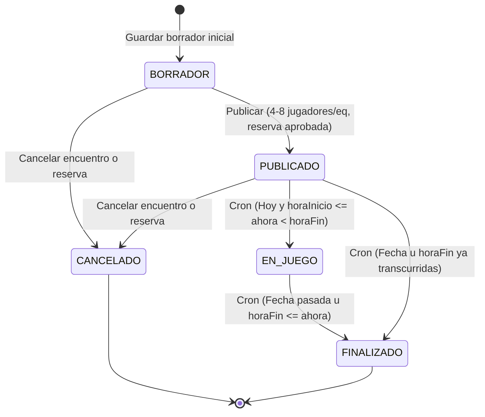

# Fase 2: Reglas de Negocio y Validaciones — Módulo de Encuentros y Partidos

**Módulo:** Encuentros, Convocatorias, Equipos y Balanceo Deportivo  
**Paquete Backend:** `com.empresa.seguridad.encuentros`  
**Archivos Fuente Auditados:**
- `com.empresa.seguridad.encuentros.application.service.EncuentroService`
- `com.empresa.seguridad.encuentros.application.service.ParametroService`
- `com.empresa.seguridad.encuentros.application.service.ReservaService`
- `com.empresa.seguridad.encuentros.application.service.JugadorService`
- `com.empresa.seguridad.encuentros.application.service.FileStorageService`
- `com.empresa.seguridad.encuentros.application.service.AuditoriaEncuentrosService`
- `com.empresa.seguridad.encuentros.domain.model.Encuentro`
- `com.empresa.seguridad.encuentros.domain.model.Equipo`
- `com.empresa.seguridad.encuentros.domain.repository.EncuentroRepository`
- `com.empresa.seguridad.encuentros.infrastructure.web.EncuentroController`

---

## 1. Proceso: Creación de Borrador de Encuentro

### 1.1. Precondiciones
1. El usuario debe ser un Director Técnico con cuenta `ACTIVO` o un Administrador.
2. La reserva asociada (`reservaId`) debe existir y encontrarse estrictamente en estado **`EstadoReserva.APROBADA`**.
   - Si no está aprobada: lanza `IllegalStateException("Solo se puede crear un encuentro sobre una reserva en estado APROBADA.")`.
3. **Regla RN-ENC-01 (Cardinalidad 1:1 Reserva-Encuentro):**
   - Una reserva solo puede tener como máximo un encuentro vinculado:
     ```java
     if (encuentroRepository.existsByReservaId(reserva.getId())) {
         throw new IllegalStateException("Esta reserva ya tiene un encuentro asignado.");
     }
     ```
4. **Regla de Propiedad:** El técnico creador del encuentro debe ser el mismo que solicitó la reserva (`reserva.getTecnico().getId().equals(tecnico.getId())`), salvo que sea Administrador. De lo contrario: `SecurityException("No puedes crear encuentros sobre reservas de otro técnico.")`.

### 1.2. Validaciones de Entrada
- `nombre`: Obligatorio (`@NotBlank`), no vacío. Se aplica `.trim()`.
- `apuestaMonto`: Opcional. Si se provee, debe ser estrictamente mayor a 0:
  ```java
  if (req.apuestaMonto() != null && req.apuestaMonto().compareTo(BigDecimal.ZERO) <= 0) {
      throw new IllegalArgumentException("El monto de apuesta debe ser mayor a 0.");
  }
  ```
- `banner`: Archivo de imagen promocional opcional (JPG, PNG, WEBP, máx 3 MB vía `FileStorageService.storeBanner`).

### 1.3. Reglas de Negocio
- Estado inicial: El encuentro nace siempre en estado **`EstadoEncuentro.BORRADOR`**.
- La cartelera pública ignora los borradores (solo se exponen encuentros en estado `PUBLICADO`, `EN_JUEGO` o `FINALIZADO`).

### 1.4. Persistencia
- `INSERT INTO encuentros`: id, reserva_id, tecnico_id, nombre, banner_url, apuesta_monto, estado (`BORRADOR`), creado_en.
- `INSERT INTO auditoria_encuentros`: Evento `CREAR_ENCUENTRO`.

---

## 2. Proceso: Asignación y Configuración de Equipos

*Método:* `EncuentroService.actualizarEquipos(Long id, ActualizarEquiposRequest req, User tecnico)`

### 2.1. Regla RN-ENC-02 (Ventana Mínima de Edición de Alineaciones):
- Si el encuentro ya se encuentra en estado **`PUBLICADO`**:
  - Se consulta el parámetro `EDICION_HORAS_MIN` (por defecto 2 horas).
  - Se calcula el margen hasta el inicio del partido:
    $$\Delta t = \text{ChronoUnit.HOURS.between}(\text{ahora}, \text{inicioReserva})$$
  - Si $\Delta t < 2\text{ horas}$: se bloquea cualquier modificación de alineaciones lanzando `IllegalStateException("Solo se permite editar jugadores hasta 2 horas antes del inicio.")`.

### 2.2. Validaciones Estructurales de Equipos
- **Regla RN-ENC-03 (Mínimo de Equipos):**
  - La lista de equipos no puede ser nula y debe contener $\ge 2$ equipos (`req.equipos().size() < 2` $\rightarrow$ `IllegalArgumentException("El encuentro debe tener al menos 2 equipos.")`).
- **Regla RN-ENC-04 (Cupo Máximo por Equipo):**
  - Ningún equipo puede registrar más de 8 jugadores (`EQUIPO_MAX_JUGADORES`):
    ```java
    if (jIds.size() > maxJugadores) {
        throw new IllegalArgumentException("El equipo '" + eqReq.nombre() + "' excede el máximo de " + maxJugadores + " jugadores.");
    }
    ```
- **Regla RN-ENC-05 (Unicidad Inter-Equipos):**
  - Un jugador no puede estar asignado a más de un equipo dentro del mismo encuentro:
    ```java
    Set<Long> jugadorIdsUnicos = new HashSet<>();
    for (Long jId : jIds) {
        if (!jugadorIdsUnicos.add(jId)) {
            throw new IllegalArgumentException("El jugador con ID " + jId + " está asignado a más de un equipo.");
        }
    }
    ```
- **Regla RN-ENC-06 (Elegibilidad y Pertenencia de Jugadores):**
  - Cada jugador asignado debe pertenecer al técnico autenticado (o el usuario debe ser Admin). Si pertenece a otro técnico: `SecurityException("El jugador [Nombre] no pertenece a este técnico.")`.
  - El jugador debe estar activo (`jugador.isActivo() == true`). Si está inactivo: `IllegalArgumentException("El jugador [Nombre] está inactivo.")`.

### 2.3. Persistencia
- Se eliminan las asociaciones de alineación previas (`encuentro.getEquipos().clear()`).
- Se persisten los nuevos equipos y su relación Many-to-Many en `equipo_jugadores`.

---

## 3. Proceso: Motor de Balanceo Automático Deportivo (Snake Draft)

*Método:* `EncuentroService.balancearEquipos(BalancearRequest req, User tecnico)`

### 3.1. Objetivo
Distribuir de manera matemáticamente equitativa a un grupo de jugadores convocados en $N$ equipos ($N \ge 2$), minimizando la brecha de nivel técnico acumulado basado en las estrellas ($1 \dots 5$).

### 3.2. Especificación del Algoritmo Snake Draft
1. **Recuperación y Ordenamiento:**
   - Se obtienen las entidades `Jugador` a partir de `req.jugadorIds()`.
   - Se ordenan en memoria en orden estrictamente descendente según su calificación de estrellas:
     $$\text{Jugador}_1 \ge \text{Jugador}_2 \ge \dots \ge \text{Jugador}_M \quad (\text{por estrellas})$$
2. **Distribución en Patrón Serpiente:**
   - Para $N = 2$ equipos ($A$ y $B$):
     $$\text{Ronda 1:} \quad A \rightarrow B$$
     $$\text{Ronda 2:} \quad B \rightarrow A$$
     $$\text{Ronda 3:} \quad A \rightarrow B$$
     $$\text{Ronda 4:} \quad B \rightarrow A$$
   - En cada paso se verifica que el equipo seleccionado no haya alcanzado el tope de `EQUIPO_MAX_JUGADORES` (8 jugadores). Si un equipo está lleno, el algoritmo salta al siguiente equipo con cupo disponible.
3. **Cálculo de Métricas por Equipo:**
   - **Estrellas Totales:** Suma aritmética de las estrellas de los jugadores asignados:
     $$\text{totalEstrellas} = \sum_{j \in \text{Equipo}} j.\text{estrellas}$$
   - **Promedio de Estrellas:**
     $$\text{promedio} = \text{round}\left(\frac{\text{totalEstrellas}}{|\text{Equipo}|}, 1\right)$$
4. **Respuesta:** Retorna una propuesta de estructura con nombres generados (`Equipo 1`, `Equipo 2`), colores contrastantes predefinidos (`#0066FF`, `#DC2626`, `#16A34A`, `#CA8A04`), métricas de balance y las listas de jugadores. No muta la base de datos hasta que el técnico confirme.

---

## 4. Proceso: Publicación de Encuentros

*Método:* `EncuentroService.publicarEncuentro(Long id, User tecnico)`

### 4.1. Precondiciones y Validaciones Estrictas
- **Vigencia de la Reserva:**
  - La reserva debe estar en estado `APROBADA`.
  - La reserva no debe haber expirado en el tiempo:
    ```java
    LocalDate hoy = LocalDate.now(ReservaService.ZONE_LIMA);
    LocalTime ahora = LocalTime.now(ReservaService.ZONE_LIMA);
    if (reserva.getFecha().isBefore(hoy) || 
       (reserva.getFecha().isEqual(hoy) && reserva.getHoraFin().isBefore(ahora))) {
        throw new IllegalStateException("La reserva ya ha finalizado.");
    }
    ```
- **Regla RN-ENC-07 (Composición Reglamentaria por Equipo):**
  - El encuentro debe contar con al menos 2 equipos.
  - Se obtienen los parámetros dinámicos:
    - `EQUIPO_MIN_JUGADORES` = 4 (por defecto).
    - `EQUIPO_MAX_JUGADORES` = 8 (por defecto).
  - Cada equipo debe tener una cantidad de jugadores dentro del rango $[4, 8]$:
    ```java
    for (Equipo eq : encuentro.getEquipos()) {
        if (eq.getJugadores().size() < minJugadores || eq.getJugadores().size() > maxJugadores) {
            throw new IllegalStateException("El equipo '" + eq.getNombre() + "' tiene " + eq.getJugadores().size() +
                " jugadores. Cada equipo debe tener entre 4 y 8 jugadores para publicar.");
        }
    }
    ```

### 4.2. Efectos
1. `encuentro.estado = EstadoEncuentro.PUBLICADO`.
2. `encuentro.publicadoEn = LocalDateTime.now(America/Lima)`.
3. Inmediatamente el encuentro se vuelve visible en:
   - Pantalla pública de inicio (`/home`, endpoint `GET /api/v1/publico/encuentros`).
   - Calendario deportivo y cartelera de partidos confirmados.
4. Registro en `auditoria_encuentros`: Evento `PUBLICAR_ENCUENTRO`.

---

## 5. Proceso: Transiciones Automáticas de Estado en Encuentros

*Clase Responsable:* `EncuentrosScheduledTasks.procesarTransicionesAutomaticas()`

Cada 15 minutos, el daemon programado evalúa los encuentros activos:



1. **PUBLICADO $\rightarrow$ EN_JUEGO:**
   - Condición: `reserva.fecha == hoy && horaInicio <= ahora && ahora < horaFin`.
2. **EN_JUEGO $\rightarrow$ FINALIZADO:**
   - Condición: `reserva.fecha < hoy || (reserva.fecha == hoy && ahora >= horaFin)`.
